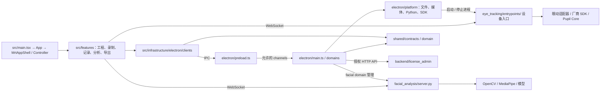
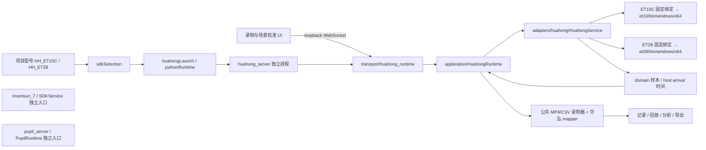

# MRT Project Manager Code Graph

本目录记录当前工作区的代码关系。架构约束仍以 [系统架构](../架构/系统架构.md) 为准。

- [自动生成的模块调用图与统计](SUMMARY.md)：先从这里阅读。
- [TypeScript 函数图](typescript.json) / [Python 函数图](python.json)：包含函数位置和调用边，适合进一步查询。
- [TypeScript Mermaid 源文件](typescript.mmd) / [Python Mermaid 源文件](python.mmd)：可用于支持 Mermaid 的文档编辑器。

## 安装与更新

已安装项目开发依赖 `@lemonberrylabs/codegraph@0.1.0`，版本记录在根目录 package.json/package-lock.json。工具来源：[lemonberrylabs/codegraph](https://github.com/lemonberrylabs/codegraph)。分析在本机进行，无需 API key。

在项目根目录运行：

```bash
npm ci
npm run docs:codegraph
```

已有依赖时只需第二条。Python 分析需要 PATH 中有 Python 3（macOS/Linux 为 `python3`，Windows 为 `python`）。无需启动设备服务或安装它们的业务依赖。生成脚本执行两次 CodeGraph 分析、归一化机器路径、核验节点源码文件并生成汇总图。

交互查看函数调用图：

```bash
npm run codegraph:serve
# 浏览器打开 http://localhost:8080

npm run codegraph:serve:python
# 浏览器打开 http://localhost:8081
```

服务运行时会重新分析当前源码；终端按 Ctrl+C 结束。可追加 `-- --watch` 跟随源码变更。上游查看器默认监听 `0.0.0.0`，并非仅本机；本次因自动审批拒绝而未启动，未验证浏览器交互。阅读本目录 Markdown 和 JSON 不需要启动服务。

## 跨进程关系

下图由源码入口、IPC 客户端和进程管理代码人工核对，是运行时通信概览；自动生成的函数图不会把 IPC/WebSocket 当作普通函数调用连接起来。



核对入口：

| 关系 | 源码 |
|---|---|
| UI 装配 | [main.tsx](../../src/main.tsx)、[MrtApplicationController](../../src/app/MrtApplicationController.tsx) |
| IPC 桥与领域注册 | [preload.ts](../../electron/preload.ts)、[main.ts](../../electron/main.ts)、[channels.ts](../../shared/contracts/ipc/channels.ts) |
| 眼动 WebSocket | [recordingWsModule.ts](../../src/features/recording/domain/recordingWsModule.ts) |
| Python 生命周期 | [pythonRuntime.ts](../../electron/platform/python/pythonRuntime.ts)、[pupilLaunch.ts](../../electron/platform/python/pupilLaunch.ts) |
| 眼动服务入口 | [server.py](../../services/eye_tracking/entrypoints/server.py)、[pupil_server.py](../../services/eye_tracking/entrypoints/pupil_server.py)、[huahong_server.py](../../services/eye_tracking/entrypoints/huahong_server.py) |
| 表情服务 | [facialHandlers.ts](../../electron/domains/facial/facialHandlers.ts)、[server.py](../../services/facial_analysis/server.py) |
| 授权服务 | [licenseService.ts](../../electron/domains/licensing/licenseService.ts)、[API 路由](../../backend/license_admin/apps/api/urls.py) |

## 覆盖范围和局限

- TypeScript：`src`、`electron`、`shared` 的 `.ts/.tsx`；Python：`services` 和 `backend`。
- 排除声明文件、测试、迁移、虚拟环境、构建目录；不扫描第三方 SDK、node_modules、工具和构建脚本。
- 只有类型/常量、没有函数的文件可能没有节点。原始调用边包含外部或缺失端点的边，汇总图只使用两端均存在的函数节点。
- JSX 渲染、顶层调用、IPC、WebSocket、Django 路由、动态导入和事件回调可能不被完整识别。跨语言边没有自动合并。
- Python 分析器按方法名寻找目标，已观察到跨服务同名误匹配。SUMMARY 的 Python 图仅是候选关系，并排除了跨独立服务的边；JSON 保留上游原始候选边，不能直接当作已确认依赖。
- 本次 TypeScript 的全部 898 个函数被上游标为 `dead`，Python 也存在大量此类标签，这是入口/动态调用分析的限制，**不能据此判断代码未使用或删除代码**。交互查看器的颜色和 JSON 中的 status 同样受此限制。
- 生成结果是静态快照；源码更新后重新生成。SUMMARY 中的数字优先于本说明中的首次扫描数字。

## 华弘生产接入关系（2026-10-07）

两款设备共用独立进程入口，按型号加载各自 runtime；这里的跨进程边由人工确认，函数扫描不能推导 WebSocket。



共享录制器增加可选 source_model/row_mapper，缺省仍为 PupilCore；RecordingPaths 和恢复逻辑按当前型号校验项目与记录。华弘不依赖 Pupil 网络或旧厂商 ctypes 类型。实际 Windows 设备验收尚待执行。

### Pupil Natural Feature 采样

`RecordingPage` 自动识别实体卡片中心→校准按钮 → `PupilRuntime.start_calibration_point` → `PupilCalibration` → `FeatureWorker`（异步启动线程→显式轻量子进程入口、有界管道与超时）→ `NaturalFeatureTracker`（BGR/JPEG 解码、等比缩小、双向光流、恢复源像素）→ 每帧 ref timestamp + pupil 源时间窗口 → 覆盖检查 → Capture Gazer3D → 匹配拟合通知并等待视频恢复 → 当前连接凭据。录制通过 PupilRecorder 将校准快照存为 `.pupil/calibration.msgpack`；独立验证标记明确为 false。

校准 start → PupilNetwork.enable_pupil_detection → Capture 已加载的两眼检测器；PupilNetwork.receive 的有界数据批次 → PupilCalibration.observe_card_data → PupilDiagnostics（topic/置信度/时间筛选）→ 双眼源时间配对 → 点结果 pupil_diagnostics → 后端 stderr 与 recordingWsModule debug。`pupil-data-v4` 增加接收诊断并修正单条读取积压，追踪子进程仍沿用 pipe-v3。
