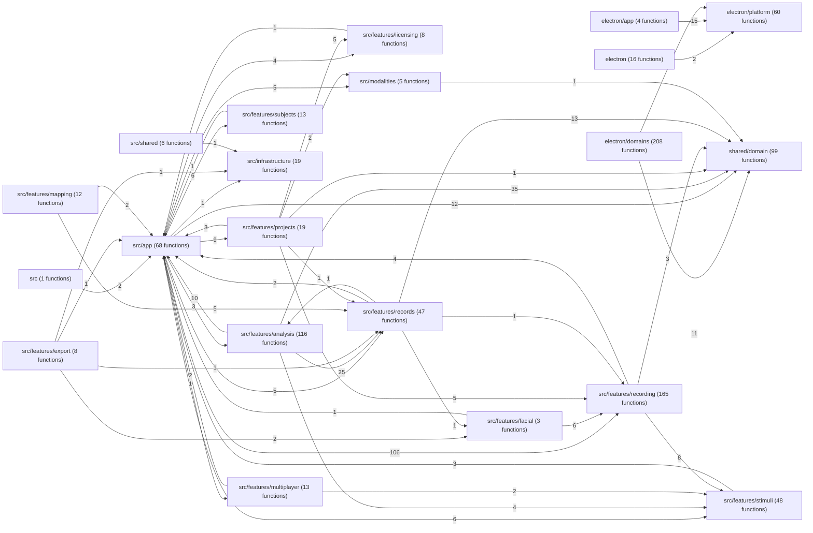
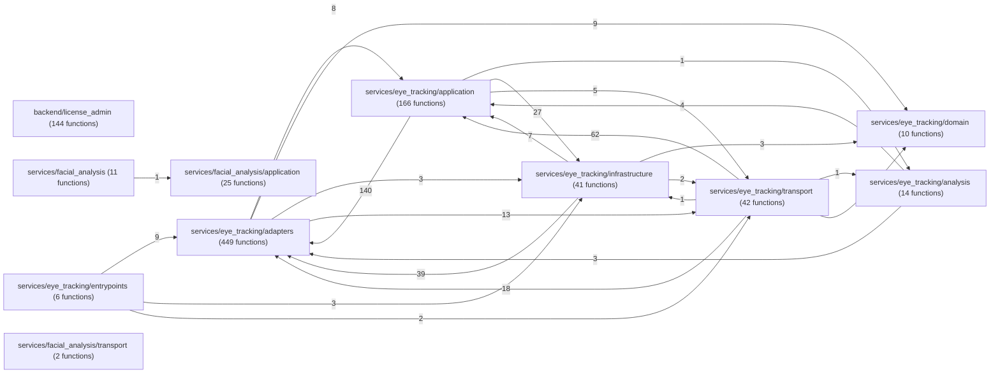

# 自动生成的代码调用图

运行 `npm run docs:codegraph` 更新。扫描当前工作区，包括未提交的源码；这不是运行时跟踪，也不是完整 import 依赖图。

| 语言 | 扫描文件 | 函数节点 | 原始调用边 | 两端有节点的边 | 外部或缺失端点边 |
|---|---:|---:|---:|---:|---:|
| typescript | 268 | 938 | 2331 | 2331 | 0 |
| python | 144 | 910 | 2498 | 2498 | 0 |

## typescript 模块调用图

箭头表示调用方 → 被调用方，数字是扫描得到的跨模块调用边数；模块内部调用省略。无跨模块边的模块仍保留。

## python 模块调用图

箭头表示调用方 → 被调用方，数字是扫描得到的跨模块调用边数；模块内部调用省略。无跨模块边的模块仍保留。

注意：Python 上游按方法名称猜测目标，不是精确的类型/import 解析。以下仅为候选调用图；已从图中排除 670 条跨独立服务的候选边，原始 JSON 保留。服务内部也可能存在同名误匹配。

