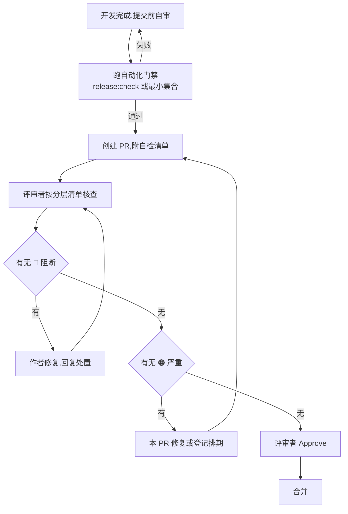

# MRT-Manager 代码审查标准与流程

> 本文是代码审查的唯一权威文档,定义审查的严重级别、分层检查清单、评审流程、自动化门禁与模板。
> 与本文相关的既有约定:[系统架构与 UI 规范](../架构/系统架构.md)(边界/依赖/不变量)、[维护手册](../维护/维护手册.md)(修改/测试/发布)。
> 适用范围:Electron 主进程与 preload、root `shared` 契约层、React renderer(`src/`)、Python 服务(`services/`)、打包/构建/脚本(`scripts/`、`SDK/`、`.spec`)。

---

## 1. 审查目标与原则

审查的唯一目的:在合并前发现并修复**正确性、安全、可维护性、性能、测试**方面的问题,同时让作者从每一次评论中学到东西。

### 1.1 四条铁律

1. **审查对准不变量,不对准风格。** 架构文档第 1 节的 7 条不变量是审查的最终裁判;tabs/空格、命名偏好等交给工具或单独提出,不阻塞合并。
2. **只评代码,不评人。** 评论描述"这段代码会怎样",不描述"你写得不好"。目标是让代码更好,也让作者更好。
3. **一次审查给完整反馈。** 不挤牙膏式分多轮抛意见;一轮里把发现的问题按严重级别全部列出。
4. **导师而非门卫。** 每个 🔴/🟠 问题都要解释"为什么"和"怎么改",并主动指出写得好、值得保留的地方。

### 1.2 五个审查维度

| 维度 | 追问的问题 |
|---|---|
| **正确性** | 它是否在正常、边界、失败路径上都做对了?是否有竞态、死锁、资源泄漏、陈旧状态覆盖新状态? |
| **安全** | 外部输入是否验证/归一化?是否绕过授权路径登记制?IPC/WS 面是否最小化? |
| **可维护性** | 6 个月后别人能读懂吗?是否违反分层依赖方向?是否制造了新的上帝组件? |
| **性能** | 是否有 N+1、同步阻塞事件循环、无界队列、全量重渲染、GB 级整读内存? |
| **测试** | 关键分支、错误路径、状态转移是否有测试?测试是否与被测模块共置? |

---

## 2. 严重级别定义

统一四级,**只按影响定级,不按修复难度定级**。每级给出判定标准与本项目实例。

| 级别 | 含义 | 合并门槛 |
|---|---|---|
| 🔴 **阻断 Blocker** | 合并即引入安全漏洞、数据丢失/破坏、崩溃、破坏协议兼容或依赖方向 | **必须修复后才能合并** |
| 🟠 **严重 Major** | 高风险隐患、明确正确性缺陷、性能热点,当前未爆发但会伤及用户或后续维护 | 本 PR 修复;确需排期的在 PR 说明登记并设 owner |
| 🟡 **建议 Minor** | 输入验证缺失、命名/结构不清、关键路径缺测试、可提取的重复 | 建议修复,不阻塞合并 |
| 🔵 **优化 Nit** | 风格、命名微调、文档缺口、可选的替代方案 | 可不改;有 linter 的交给 linter |

**与历史报告的优先级映射**:🔴≈P0、🟠≈P1、🟡≈P2、🔵≈P3。

### 2.1 定级实例(取自本项目真实审查)

| 实例 | 定级 | 理由 |
|---|---|---|
| Python WS 服务 `0.0.0.0` 无鉴权监听 + 任意路径写入 | 🔴 | 局域网任意主机即可读写任意路径,即时可利用 |
| 录屏误删、mux 孤儿进程、退出卡死 | 🔴 | 数据丢失 / 资源泄漏 / 无法退出 |
| `delete-project` 未校验目录在授权根内 | 🟠 | 与 AuthorizedPathRegistry 安全模型未闭环 |
| `recordId` 未过滤 `../` 可越出 projectDir 读写 | 🟠 | 路径穿越,受信任输入被绕过 |
| `findFfmpegBinary` 同步扫描数千目录阻塞主进程 | 🟠 | 性能热点,用户可感知卡顿 |
| 20Hz gaze 数据走顶层 React state 全树重渲染 | 🟠 | 录制期性能大头(已登记为专项债务) |
| 重复工具函数(`asRecord`/`getErrorDetails` 等 5+ 处) | 🟡 | 应提取,不阻塞 |
| 未使用的 import、`key={index}`(静态列表) | 🔵 | 卫生项,渐进清理 |

> 判断经验:如果一个问题需要"在特定输入/特定设备/特定时机"才触发,但一旦触发就造成破坏,它往往比"每次都慢一点"更严重。安全与数据完整性永远高于风格与微优化。

---

## 3. 分层审查清单

> 每条清单都对应架构文档的一条不变量或既有门禁。审查时按变更所属层逐条勾选;**触及多个层时必须全查**。

### 3.1 全层通用(任何文件都查)

- [ ] **输入边界**:来自 IPC/WS/磁盘/URL 的 `unknown` 数据,进入内部模型前已验证或归一化(架构不变量 3)。
- [ ] **资源所有权**:进程、媒体、窗口、监听器、定时器有唯一 owner 与清理路径;effect 清理 listener/timer/media/WS(不变量 4)。
- [ ] **竞态**:陈旧响应不能关闭新 operation、覆盖新状态;异步结果有取消/令牌。
- [ ] **超时**:所有 `subprocess`、网络请求、`urlretrieve`、socket 收发均有超时,不裸 `await` 无界等待。
- [ ] **死代码**:不提交零生产调用的模块/函数,不提交未使用 import(见 H3 教训:死代码会误导维护者)。
- [ ] **错误处理**:不 `except Exception: pass` 静默吞错;关键路径失败有日志与回滚。

### 3.2 Electron 主进程与 preload(`electron/`)

- [ ] **依赖方向**:`platform` 不反向依赖 `domains`;`main.ts` 只装配、不写业务;handler 归 `electron/domains`。
- [ ] **IPC 最小面**:channel 统一登记在 `shared/contracts/ipc/channels.ts`;preload 用 allowlist,不开放任意 channel。
- [ ] **安全模型闭环**:文件写/删/读都经过 `AuthorizedPathRegistry`;`recordId`/路径参数过滤 `../`、`\`;不对渲染端传的任意路径直接 `rm recursive` 或 `unlink`。
- [ ] **窗口安全**:`contextIsolation: true`、`nodeIntegration: false` 显式声明;加载含用户数据 HTML 的窗口不复用 `sandbox:false` 的宽松配置。
- [ ] **主进程不阻塞**:文件哈希、目录扫描、ffmpeg 探测等 I/O 不 `spawnSync`/同步 `readdir` 阻塞主进程;GB 级文件用流式 `createHash` + pipe。
- [ ] **退出清理**:新增的长驻资源(录屏 ffmpeg、Python 进程、定时器)接入 `appShutdown` 的 will-quit / before-quit 依赖表。

### 3.3 root `shared` 契约层

- [ ] **运行时无关**:不 import React、Electron、DOM、Node I/O(门禁 `check-architecture.mjs` 强制)。
- [ ] **可序列化稳定**:DTO 字段可序列化;升级响应先兼容旧字段,不静默重命名。
- [ ] **无 `Record<string, any>` 代替模态契约**:新模态走 `ModalityId` 判别配置,不靠 `hiddenTabs` 或设备型号硬编码。

### 3.4 React renderer(`src/`)

- [ ] **分层**:`app → features → infrastructure / src/shared → root shared`;feature 不反向依赖 `app`、不直接导入其他 feature 的 Page/Modal/私有 hook。
- [ ] **IPC 走门面**:`src/infrastructure` 之外不得直接访问 `window.ipcRenderer`(门禁强制)。
- [ ] **纯函数下沉**:统计、归一化、时间换算、模态过滤提取为纯函数并测试,不堆在组件里。
- [ ] **性能**:高频数据(如 20Hz gaze)不逐样本重建 40+ 字段对象、不进顶层 state 引发全树重渲染;列表避免无谓 `key={index}`。
- [ ] **竞态与副作用**:快速切换项目/记录时,旧异步响应不得覆盖新状态(persist/load 加取消或令牌);localStorage 单一 key 只一处读写。
- [ ] **错误边界**:lazy 页面外层有 `ErrorBoundary`,单页抛错不白屏整个应用(见 H2 教训)。
- [ ] **可访问性**:图标按钮有 `title`/`aria-label`;折叠按钮有 `aria-expanded`;禁用态同时设 `disabled` + 不可点击光标。
- [ ] **UI 规范**:复用相邻页面字号/间距/圆角;条件表单用自动流式网格,不用空 `<div />` 占位;模态名称只从 `MODALITY_REGISTRY` 取。
- [ ] **视觉一致性**:按[当前 UI 设计规范](../架构/系统架构.md#6-当前-ui-设计规范)区分普通灰色操作与透明文字/Tab,主按钮不恢复蓝底;主导航和设置菜单选中无外边框;选择下拉无缝拼接,独立操作菜单四角完整;保留 AOI 默认边框、焦点及数据图形颜色。
- [ ] **数字与标题稳定**:动态数值片段使用共享等宽字体与 tabular-nums 并为位数增长预留宽度,标签不被强制改为等宽字体;可多行标题平衡换行、连续长名称可断行,中英文与窄窗口不溢出或形成明显孤词,单行导航和工具栏不受影响。
- [ ] **圆角与层次**:仅紧邻等距的嵌套轮廓按外层圆角等于内层圆角加内边距计算,使用平台共享变量;弹窗使用独立圆角,不能由远处输入框加正文留白推算。下拉接合角及圆形/数据控件保留例外。表面默认色阶分层,需要分离的卡片及浮层使用对应共享多层柔和阴影,不叠加生硬描边、厚重投影或嵌套阴影,不删除 AOI 默认边框和键盘焦点。
- [ ] **弹窗一致性**:短确认、长表单、设置、嵌套添加、导出参数和预览复用共享 Modal;标题/正文/操作区同一主表面,关闭图标默认透明,遮罩不模糊背景。外壳受视口约束,正文滚动且关闭/操作区可见,检查小窗口与英文长标题;视觉统一不新增遮罩或 Escape 关闭行为,不改变取消/确认契约及父级状态。
- [ ] **入场动效**:按少量语义分组错开淡入和轻微位移,只动画 opacity/transform;含 Portal 触发器的内容区仅淡入以保持定位贴合。仅首次显示或重开时执行,数据刷新不重播;尊重 prefers-reduced-motion,不通过动画延迟操作、焦点或错误提示,不动画实时采集内容。
- [ ] **UI 验证证据**:按[UI 回归清单](../维护/维护手册.md#41-react-与-ui)覆盖实际影响页面与弹窗,检查浅深色和控件状态的计算样式与交互;不能只凭 JSX 类名或一张截图认定通过,模拟平台不等于实机验收。

### 3.5 Python 服务(`services/`)

- [ ] **分层**:`server.py` 只装配;协议归 `transport`,用例归 `application`,设备/驱动归 `adapter`/`sdk_driver`。
- [ ] **网络面**:监听 `127.0.0.1`(或 token 握手);不接受客户端任意 `output`/`project_path` 路径,写路径白名单化。
- [ ] **事件循环不阻塞**:cv2 开摄像头、ffmpeg `subprocess.run`、模型下载、`stop_device` 等同步 I/O 用 `asyncio.to_thread`;不裸 `await` 无界队列。
- [ ] **广播模型**:notify 用广播 + per-client `asyncio.wait_for` 发送超时;单慢客户端不阻塞整个广播循环;无消费者时队列不无限堆积。
- [ ] **退出顺序**:停止接收命令 → 停采集/录制 → flush/close → 关连接和端口;`stop_device` 内线程 join/ffmpeg 收尾移出事件循环。
- [ ] **解析健壮**:协议解析不因脏数据崩溃;数值转换用 `_to_int`/`_to_float` 类容错,不用裸 `int()` 直接崩。

### 3.6 打包 / 构建 / SDK / 脚本

- [ ] **仓库卫生**:不提交 `dist*`、`release`、`.venv`、`__pycache__`、缓存、日志(门禁 `check-repository-hygiene.mjs` 强制)。
- [ ] **SDK 边界**:应用源码不入 `SDK/`;不格式化/批量改写厂商供应物(门禁强制)。
- [ ] **PyInstaller spec**:`upx=False`(避免压缩 cv2/mediapipe DLL 致启动崩溃/杀软误报);运行时依赖的 SDK 目录、ffmpeg 路径在部署文档固化。
- [ ] **脚本自说明**:迁移脚本说明输入根目录、备份、幂等、失败恢复;脚本路径/产物在 `package.json` 与文档中真实存在。

---

## 4. 审查流程

### 4.1 审查时机

| 时机 | 触发 | 执行人 |
|---|---|---|
| **提交前自审** | 每次发起 PR 前 | 作者 |
| **PR 评审** | PR 创建后、合并前 | 1 名评审者(关键路径 ≥1 名专家) |
| **发布前复核** | 进入发布检查表前 | 评审者 + 负责人 |

### 4.2 角色与职责

- **作者**:跑完自动化门禁 + 自检清单后才提交;小 PR(单一意图)优先;对每个 🔴/🟠 回复处置方式。
- **评审者**:按 §3 清单逐层核查,给出定级明确的完整反馈;不替作者改代码。
- **负责人(owner)**:对 🔴 是否必须、🟠 是否可排期做最终裁决;维护技术债务登记。

### 4.3 流程



**关键规则**

1. **门禁先行**:人工审查只审自动化查不出的东西(业务正确性、安全语义、可维护性),不审机器能查的(类型、依赖方向、仓库卫生)。
2. **小步提交**:一个 PR 一个意图;超 500 行的文件变更进入结构评审(对应架构文档"500/800 行护栏")。
3. **🔴 一票否决**:任何 🔴 未闭合不得合并;🟠 允许"登记 + owner + 排期"后合并,但同一 PR 不得积累超过 3 个待排期 🟠。
4. **处置闭环**:作者对每一条 🔴/🟠 必须明确回复"已修复 / 不修复+理由 / 转排期";不回复视为未处理。

### 4.4 自动化门禁(已具备,直接映射)

| 门禁 | 命令 | 拦截内容 |
|---|---|---|
| 架构守卫 | `npm run check:architecture` | 依赖方向、IPC 边界、legacy 布局、SDK 混入 |
| 仓库卫生 | `npm run check:hygiene` | 禁止跟踪的缓存/构建文件、必需文档缺失 |
| 生产类型 | `npm run typecheck:all` | 前后端生产代码类型错误 |
| Python 编译 | `npm run check:python` | Python 源码语法(排除 `.venv`) |
| SDK 校验 | `npm run check:sdk` | 三设备 SDK 关键发布文件 |
| 构建 | `npm run build` | 前端 + 主进程可构建 |
| 全链发布 | `npm run release:check` | 以上全部 + `git diff --check` |

CI 中至少挂载 `release:check` 作为合并门；本地开发阶段使用最窄静态检查和对应门禁快速反馈。

### 4.5 人工审查重点(机器查不出,必须人看)

- 协议/磁盘**兼容性**:新字段是否可选、是否有默认值、旧格式是否可读(不变量 1/8)。
- **安全语义**:授权路径是否真正闭环,而不是"看起来有校验"。
- **生命周期正确性**:operation id 是否贯穿全流程;正常与异常退出是否都清理。
- **业务正确性**:多模态回滚、局部失败不抹除其他模态结果(不变量 5)。
- **债务是否加剧**:是否往已有的上帝组件里继续加职责(见 §6 债务清单)。

### 4.6 合并标准(Definition of Done)

一个 PR 满足以下全部条件才可合并:

- [ ] `release:check`(或对应 CI)通过。
- [ ] 无未闭合的 🔴;🟠 已修复或登记排期(≤3 个)。
- [ ] 关键分支有测试(纯函数边界/错误输入、状态转移、IPC 验证、协议解析)。
- [ ] 依赖方向与文件 owner 正确,无新增架构违规。
- [ ] 文档(如变更了协议/命令/字段/打包路径)已同步。
- [ ] 真实设备/Windows 依赖的改动,已如实标注"未做设备/系统验收"。

### 4.7 度量与持续改进

每月回顾一次,用四个指标校准标准:

| 指标 | 定义 | 目标 |
|---|---|---|
| 缺陷逃逸率 | 合并后发现的 🔴+🟠 / 总合并缺陷 | 持续下降 |
| 审查覆盖率 | 有评审者 Approve 的合并 / 总合并 | 100%(关键路径) |
| 平均评审时长 | PR 创建到合并 | 参考值,不追求越短越好 |
| 债务变化 | §6 债务清单项数增减 | 不新增,只收敛 |

指标只为发现流程问题(如"某类缺陷反复逃逸说明清单缺项"),不作为个人考核。

---

## 5. 模板

### 5.1 PR 自检清单(作者提交时附在 PR 描述)

```
## 变更意图
(一句话:改了什么,为什么)

## 自检
- [ ] 已跑 release:check(或最小门禁集合)
- [ ] 依赖方向与文件 owner 正确
- [ ] 外部输入已验证/归一化;未绕过 AuthorizedPathRegistry
- [ ] 生命周期只清理自己资源;异步有取消/超时
- [ ] 关键分支/错误路径/状态转移有测试
- [ ] 涉及协议/磁盘/命令/字段变更的文档已同步
- [ ] 涉及真实设备/Windows 的改动已标注未验收项

## 风险与遗留
(如🟠 排期项:编号 + owner + 计划版本)
```

### 5.2 审查意见模板

```
🔴 安全:任意路径写入
位置:electron/domains/xxx/xxxHandlers.ts:123

为什么:渲染端传入的路径直接 join 后写入,未经过 authorizedPaths.isAuthorized,
可被构造请求写到任意目录(与 AuthorizedPathRegistry 模型未闭环)。

建议:
- 写入前加 isAuthorized(dir) 守卫;
- 对含 ../、绝对路径、盘符的段做拒绝。
```

### 5.3 审查结论记录

```
审查对象:PR #xxx / commit xxx
评审者:xxx       日期:2026-xx-xx
结论:🔴 x 个 / 🟠 x 个 / 🟡 x 个 / 🔵 x 个
🔴 处置:全部修复(逐条确认)
🟠 处置:已修复 a、b;c 转排期(owner=xxx,目标版本)
合并判定:通过 / 需返工
```

---

## 6. 附录:与既有门禁、债务的关系

- **四道自动化门禁**(architecture/hygiene/python/sdk)是审查的"机器层",本清单的 §3.2/3.3/3.4 中标注"(门禁强制)"的条目无需人工重复验证,评审者直接采信 CI 结果。
- **已登记债务**(见架构文档 §9)在审查中不要求顺手解决,但**不允许继续扩大**:向 `MrtApplicationController`、`AoiPage`、`RecordingPage`、`sdk_service.py` 等上帝组件加新职责,应提示作者先做最小拆分或明确说明。
- **历史审查报告**(`docs/代码审查报告-*.md`)是定级标尺的"判例库":遇到拿不准级别的问题,对照报告中同类问题的定级保持一致。
- 本文如与架构文档/维护手册冲突,以架构文档为准(架构 > 审查标准 > 维护手册);冲突时先改文档、再改代码。
