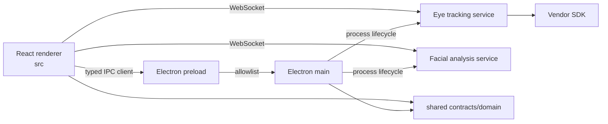

# MRT Project Manager 系统架构与 UI 规范

> 本文是架构目录唯一的权威文档，合并了原系统架构、目录职责、依赖规则、多模态工程架构和技术债务。日常修改、验证与发布流程见 [维护手册](../维护/维护手册.md)。

## 1. 目标与不变量

项目由 React Renderer、Electron main/preload、Python 设备服务、共享契约和厂商 SDK 组成。任何修改必须保持以下不变量：

1. IPC channel、WebSocket 命令、端口、磁盘目录、文件名和导出字段保持兼容。
2. 工程能力由 `Project.modalities` 决定，设备型号只是眼动模块配置。
3. 进程间只通过显式契约通信；外部输入验证或归一化后才能进入内部模型。
4. 录制 operation、设备进程、媒体、窗口和监听器有唯一 owner 与清理路径。
5. 公共工程、受试、设计、录制、记录和导出页面不为每个模态复制一份。
6. UI 的模态选择、导航、记录、导出和预览使用同一个 `ModalityId`，不得交叉加载。
7. 自动化通过不等于真实设备、Windows 安装和科学结果已经验收。
8. 所有设备接入时，只要涉及校准，统一复用原 7invensun 校准界面与交互入口，不新增厂商独立校准页面或窗口。
9. 所有眼镜式设备的 AOI、可视化和时间轴统一以完整录制视频作为记录刺激物；厂商接入不得另建刺激物或分析规则。

### 设备校准接入标准

本标准适用于已有设备及后续新增的全部厂商、型号。校准与录制均由本软件录制页面发起和控制；统一复用已有校准界面，核心组件为 `src/features/recording/FullscreenCalibrationOverlay.tsx`，并复用录制页已有的内嵌校准区域及状态管理。

- 厂商差异通过设备能力配置、适配器和共享校准组件的扩展参数处理，包括校准点数、自动/点击采样、目标样式、完成条件及结果校验。
- 复用界面不意味着强行使用 7invensun 的 SDK 协议或算法。必须遵循各设备真实的数据坐标系和校准要求；例如 Pupil 使用场景相机中的实体卡片中心作为参考位置，由共享卡片流程选点并按相机源时间配对瞳孔数据。
- 启动、采样、完成、取消、失败和结果提示均在本软件现有流程内完成。需要厂商服务时，其作为后台设备服务，不要求用户切换厂商软件操作校准。
- 校准命令 ACK 不作为成功结果；处理取消、超时、断连、迟到回调和失效结果，避免旧校准结果误授权采集。
- 新设备接入验收必须检查共享校准界面兼容性，并验证 7invensun、Pupil 和华弘已有流程不受影响。不得以新增独立页面绕开共享界面的适配。
- 华弘 ET28（`HH_ET28`）是眼镜式，能力配置选择现有卡片式三/五/九点，默认卡片式五点，提交实体卡片中心在场景图中的归一化坐标。ET10（现有 SDK 型号 `HH_ET10C`）是桌面式，沿用 7invensun 桌面全屏/被试屏和自动三/五/九点流程。型号适配不新建页面或组件。
- ET28 固定场景 1920×1080、SDK 中心裁剪 1、追踪平滑系数 12，复用原分辨率下拉且仅显示此项；旧配置不能恢复其他组合，设备不支持时明确失败。实体卡片校准使用双眼一起采样的一轮 `TWOEYE`，对应厂商 demo 未勾选单眼模式；不增加左眼、右眼分轮或独立合并步骤。

### 设备视频流生命周期

进入或返回录制页不自动连接视频流。用户点击“开启设备”后，才建立当前设备的预览与眼动数据通道；连接维护仅在该手动开启会话有效时运行。点击停止或离开录制页时停止预览和设备，返回后必须再次手动开启。导航等待停止操作完成，迟到的设备启动响应不得恢复已取消的连接。录制文件正在收尾时继续保存，禁止因页面切换破坏保存流程。

### 眼动分析跨设备与平台标准

数据可视、映射描点、AOI 分析、统计报表和洞察报告统一面向所有眼动设备，包括 7invensun、华弘 ET28/ET10、Pupil 和后续设备。入口只按工程模态、全局页面配置和产品授权判断；设备能力配置不隐藏分析页面。保留原界面和操作流程。

- 离线分析不依赖当前连接的设备、校准状态、厂商 SDK、相机配置或采集系统要求。Windows 设备的历史记录可在具备分析运行环境的其他系统上处理。
- 模块按实际输入工作：映射需要视频、参考图和注视点；AOI 需要区域和对应坐标；统计、洞察只使用存在的数据。缺少媒体、眼动数据或某项指标时保留缺失提示，不因品牌禁用整个模块，也不补造物理量。
- `electron/platform/python/analysisLaunch.ts` 独立构造映射命令，不调用采集的 `getPyServerCommand`。源码直接启动共享 `analysis.gaze_mapper --job`；打包按可用程序启动统一 `--gaze-map-job`，三个入口均在导入设备运行时之前分派。选择依据安装情况，与工程型号无关。
- 分析进程仅要求 Python/OpenCV/NumPy 等分析依赖。源码优先 `MRT_ANALYSIS_PYTHON_BIN`、通用 `MRT_PYTHON_BIN`，然后使用已安装项目环境或系统 Python；不读取厂商专用解释器或可执行程序配置。缺少运行环境时明确报错，不能回退启动设备。

### 可视化与映射注视事件标准

7invensun、ET28、Pupil 和其他设备共用现有可视化、映射描点及 AOI 的 `fixation` 分析数据入口。轨迹按事件时间排列并编号，圆点和热图权重使用注视持续时间；界面、颜色、连线和控制项继续复用原组件。供多个可视化模式共用的数据不得先按空间网格聚合，否则会合并不同时间对同一区域的注视。

- 记录已有注视事件时保留其算法结果、坐标、ID、持续时间和完成状态，不重新分类，也不把未完成事件认作完整事件。
- 整份记录没有注视事件时，在主进程建立分析索引时，复用 7invensun 眼镜已有 MRT 回退规则：推荐坐标到运行中心的距离不超过源图像 35 像素、至少 100 毫秒及 6 个有效样本。仅使用已明确对齐 `video_time_ms` 的数据；无效样本、眨眼、非递增时间、超过 100 毫秒的采样断档和刺激物切换终止当前候选。文件末尾只保留达到门槛的事件。
- 回退事件标记 `fixationSource: mrt_7invensun_fallback`，只写可重建的 `.analysis-events.csv` 与 `.points.index.json`。这是软件识别结果，不是厂商 SDK 的注视事件，也不等同于视角算法。原始 CSV、视频及厂商事件不改写；原始 gaze 读取保持可用。
- 全记录映射、分窗回放和可视化复用同一份索引，事件识别在时间筛选和抽样之前完成。已标明视频毫秒的事件不再推测单位、拉伸或平移；稀疏数据和单个事件也保留原视频位置。旧空索引在解析版本升级后自动重建。

### 眼镜式完整视频刺激物接入标准

Pupil、7invensun aSeeGlassesPlus、华弘 ET28 和后续新增眼镜设备共用 `shared/domain/recordingStimulus.ts` 的记录视频派生规则。设备适配与记录加载须提供正确的 `deviceType: '眼镜式'`、稳定记录 ID、视频路径或 URL 和实际视频时长；分析层不维护厂商白名单，也不根据眼动点数量推断媒体是否存在。

- 完整录制视频是该记录的分析刺激物，范围为 `0..实际媒体时长`，单位为秒。已加载的有效媒体时长优先于记录的 `durationSeconds`；视频或有效时长缺失时不伪造刺激物区间，媒体就绪后再派生。
- 派生标识固定为 `record:<记录ID>`，延续现有 AOI 保存作用域。同名记录仍各自保存 AOI，重命名记录不改变作用域。不复制视频，不把派生记录刺激物写入实验素材库，也不回写历史原始 CSV。
- 共享 `TimelineAnalysis` 显式接收完整视频刺激物；即使 CSV 没有刺激物名称、眼动点为空或存在采样间隔，仍展示完整视频条。已有 CSV 中的刺激物切换不能分割这条视频；Marker 和 Trigger 保留原时间，不受残留素材筛选影响。
- 用户创建的全局时间片、AOI 统计范围及动态 AOI 关键帧仍分别保存；它们只限制统计或播放范围，不裁短或替代完整视频刺激物。不得通过补造眼动点、修改坐标或重写时间戳生成刺激物条。
- 新眼镜录制的后端刺激物名称使用本次录制视频名称，与记录视频关联；历史记录通过上述只读派生规则兼容。桌面设备保留实验素材与播放片段规则，映射结果保留静态参考图空间。
- 可视化右侧保留现有“刺激材料筛选”下拉样式，眼镜式默认项为整段录制视频；未选记录时使用工程类型，选中后以记录类型为准。映射模式仍保留参考图规则，不新增厂商专属控件。

## 2. 运行时与依赖方向



入口：

- Renderer：`src/main.tsx → src/App.tsx → src/app/MrtAppShell.tsx → MrtApplicationController`。
- Main：`electron/main.ts → electron/app → electron/domains → electron/platform`。
- Preload：`electron/preload.ts → shared/contracts/ipc/channels.ts`。
- 眼动服务：`services/eye_tracking/entrypoints/server.py → transport → application → adapters/invensun_7/sdk_driver.py`。
- 表情服务：`services/facial_analysis/server.py → transport/application → OpenCV/MediaPipe/model`。

允许依赖方向：

```text
Renderer: app → features → infrastructure / src/shared → root shared
Main:     main/app → domains → platform → root shared
Python:   entrypoint → transport → application → adapter/resources
```

禁止事项：

- feature 反向依赖 `src/app`，或直接导入其他 feature 的 Page、Modal、私有 hook。
- `src/infrastructure` 之外直接访问 `window.ipcRenderer`。
- Electron 导入 Renderer；root `shared` 导入 React、Electron、DOM、Node I/O。
- preload 开放任意 channel，或在 `electron/main.ts` 直接实现领域 handler。
- 应用运行时导入 `tools`，或把应用源码放入 `SDK`。
- 为消除架构门禁而扩大永久 allowlist。

## 3. 目录与所有权

| 路径 | 所有内容 | 典型落点 |
|---|---|---|
| `src/app` | Shell、路由、跨领域协调、全局布局/设置 | Sidebar、Header、Controller、workspace |
| `src/features` | 按业务能力组织的页面、状态和领域逻辑 | projects、recording、records、analysis、export、facial |
| `src/modalities` | 模态名称、固定顺序、页面能力注册 | `registry.ts` |
| `src/infrastructure` | Renderer 的 IPC/浏览器技术适配 | typed clients、events、logging |
| `src/shared` | 仅 Renderer 复用的无领域 UI/常量/类型 | Modal、CustomSelect、Spinner |
| `electron/domains` | IPC 输入验证和主进程领域能力 | project、recording、mapping、facial、export |
| `electron/platform` | OS、Python、SDK、FFmpeg、日志 | process、media、runtime |
| `shared/contracts` | 可序列化 DTO、channel、稳定类型 | Project、RecordingRecord、IPC |
| `shared/domain` | 跨运行时纯函数 | project/record modality、timeline、AOI |
| `services` | Python transport、application、adapter | eye_tracking、facial_analysis |
| `SDK` | 厂商原始供应物 | 二进制、模型、头文件、样例 |
| `scripts` | 构建、检查、迁移、恢复 | architecture/hygiene/release scripts |
| `tools` | 独立开发工具 | communication-debugger |
| `docs` | 架构、维护、用户和业务资料 | 不参与运行时 |

`services/` 的源码、环境、模型、发行产物与缓存边界见 [服务目录说明](../../services/README.md)。三个眼动进程入口位于 `eye_tracking/entrypoints/`，离线分析位于 `eye_tracking/analysis/`，Pupil 依赖清单位于 `eye_tracking/requirements/`。离线注视映射复用 `eye_tracking/analysis/gaze_mapper.py`；三个设备入口均在导入采集运行时前处理 `--gaze-map-job`；源码离线分析直接进入共享分析模块，映射任务不启动相机或 WebSocket 服务。2026-10-16 目录整理后的手动命令迁移也记录在服务目录说明中。

文件命名职责：

- `*Page.tsx` 负责页面组合，不解析协议或实现复杂算法。
- `*Panel/*Modal/*Overlay` 只负责一个交互区域。
- `use*.ts` 管理 React 生命周期；纯计算提取为普通函数。
- `*Client.ts` 是 Renderer IPC 边界；`*Handlers.ts` 是 Main IPC 适配器。
- `domain/*.ts`、`*Model.ts` 优先保持无 I/O、可单测。
- `server.py` 是装配入口；协议归 `transport`，用例归 `application`。

结构护栏：超过 500 行进入结构评审；超过 800 行默认不得继续增加新职责。拆分必须按 owner、I/O 和测试边界进行，不能只为减少行数。

## 4. 多模态工程模型

用户界面统一使用“眼动模块”和“表情模块”；技术 ID 保持 `eye-tracking` 与 `facial-expression`。眼动仪、眼动数据、眼动速度、表情分析等专业术语不因模块命名改变。

```json
{
  "schemaVersion": 2,
  "modalities": [
    { "id": "eye-tracking", "enabled": true, "config": { "deviceType": "桌面式", "deviceModel": "Pro" } },
    { "id": "facial-expression", "enabled": true, "config": { "width": 1280, "height": 720, "fps": 30 } }
  ]
}
```

- 一个工程至少启用一个模态；工程管理通过“文字 + toggle”的多选下拉修改。
- schema v1 或无 `modalities` 的旧工程归一化为眼动模块工程。
- `src/modalities/registry.ts` 是名称、图标、说明、页面和导航顺序的唯一来源。
- 固定导航顺序为眼动分析在前、表情分析在后，不跟随用户勾选顺序轮换。
- 公共页面：工程管理、受试管理、实验设计、实验录制、实验记录、数据导出。
- 眼动页面：数据可视、映射描点、AOI 分析、统计报表、洞察报告。
- 表情页面：面部分析。

统一记录模型使用 `RecordingRecord.modalities`。旧眼动记录没有声明模态但存在 CSV 时仍按眼动处理；显式仅表情记录不得进入眼动分析。

## 5. 模态数据边界

### 5.1 录制与记录

- 多模态录制共用记录名和生命周期；启动失败要回滚已启动模态。
- 后端录制收尾通知必须匹配当前已确认录制的 ID 或视频路径；启动 ACK 前先保留结果，身份不符或重复结果不触发设备、音频清理。录制中途异常结束也必须退出录制状态，旧启动的异步延续不得重新启用采集；收尾清理完成前不能启动下一次录制。
- 停止时各模态独立落盘，局部失败不得抹除其他模态结果。
- 实验记录页的模态下拉来源是工程配置，不依赖是否已经产生记录。
- 多模态记录在各模态视图分别出现；详情页按当前模态加载对应数据。
- 数据可视、映射描点和 AOI 分析只能接收眼动记录。

### 5.2 导出

数据导出以当前 `ModalityId` 驱动五个环节：下拉选择、记录列表、导出参数、实际导出、数据预览。

- 眼动模块：现有 CSV 字段、受试属性合并、批量 CSV 和眼动预览。
- 表情模块：源视频 MP4、完整分析 JSON、基础表情事件 CSV、分析采样点预览。
- `src/features/export/domain/modalityExportRegistry.ts` 负责模态匹配和导出显示定义。
- 新模态不能只增加下拉选项，必须同时完成记录匹配、参数、执行器、预览转换和测试。

## 6. 当前 UI 设计规范

本节为当前 UI 风格的唯一完整规范，按截至 2026-10-24 已确定的交互与视觉要求整理。适用于 Windows/macOS、浅色/深色、所有页面与弹窗，包括授权页、嵌套弹窗、Portal 下拉和有数据后才出现的控件。新增模块沿用这些规则；局部旧样式与本节冲突时按本节修正，不再建立另一套主题或控件。后续用户明确调整某项设计时，同步更新本节与维护手册。

核心区分：**普通输入框、选择框、操作按钮使用统一灰色；名称、Tab、折叠标题和文字动作使用透明底色；具有数据或状态含义的颜色保留。** “统一灰色”不等于给所有可点击区域铺灰底，“去灰底”也不等于把所有输入框和操作按钮改为透明。

### 6.1 总体风格

界面采用克制、紧凑的科研工具风格，仅保留浅色（默认 `modern-light`）和深色（`dark`）两套独立调校的主题。布局按既有 4px 间距网格对齐，默认以相邻约 1%–3% 明度差的中性表面区分层级；需要进一步分离的卡片可使用共享低强度多层柔和阴影，不用生硬的装饰描边构建面板。浮层与弹窗使用对应层级的共享阴影。禁止为新模块另起一套颜色或大面积渐变。旧 `deep-blue` 偏好自动迁移到 `dark`，Renderer 与 Electron 标题栏同步。

| 元素 | 规范 |
|---|---|
| 页面容器 | `bg-white` 映射主题主表面，`bg-slate-50/100` 映射相邻色阶；中性装饰边框透明，需要分离的卡片可使用 `mrt-surface` 柔和阴影；保留紧凑间距，嵌套圆角按第 6.4 节计算 |
| 页面工具栏 | `px-4 py-3`，控件 `py-1.5`，避免 `p-8` 式过宽头部 |
| 主色 | 浅色 `#326bb5`，深色 `#8aaee0`，后者提亮并降低饱和度，用于链接、焦点及数据/状态标识；所有操作按钮（包括创建、保存）与输入框统一灰色，不再使用蓝底白字主按钮 |
| 浅色层级 | 底色 `#f5f6f7`、主表面 `#ffffff`、次表面 `#f8f9fa`、分组 `#f1f2f4`；正文 `#292b30` |
| 深色层级 | 炭灰底色 `#1e1f22`、主表面 `#242529`、次表面 `#2a2b2f`、分组 `#303136`；正文 `#d9dadd`，避免纯黑/纯白 |
| 正文 | `slate-700/800/900`；次级文字 `slate-600`，辅助文字 `slate-400/500`，分别映射 `--app-secondary-text` / `--app-muted` |
| 状态 | 成功绿色、采集中玫红；等待文字使用黑/深灰，黄色只保留小状态点 |
| 视频画布 | 保留视频所需的 `bg-black`；空画布使用主题中性色，控制栏结构保持眼动与表情一致；分析图形轮廓与数据颜色不作为装饰描边移除 |
| 表格 | 固定表头、紧凑行高、悬停浅灰、勾选整行浅蓝、数值与操作列右对齐 |
| 弹窗 | 标题/内容/操作区共用 `--app-surface`，通过字号与留白组织，不添加灰色头尾条；共享小圆角、低强度多层柔和阴影与黑色 40% 遮罩，遮罩不模糊背景 |

Windows 在共享主题上使用平台变量微调：浅色次表面 `#fafafa`、分组 `#eef0f2`；深色次表面 `#292a2e`、分组 `#32343a`，正文与辅助文字同步调整对比。控件灰阶跨平台统一，不单独覆盖 Windows 控件底色。底色、主表面及品牌色保持共享值，与 Electron 标题栏一致。平台标记在 Renderer 首次渲染前设置，macOS 与其他平台沿用默认样式。

普通输入框、下拉框和所有操作按钮共用一套控件色阶，确保同状态、同主题下底色一致：

| 控件状态 | 浅色 | 深色 |
|---|---|---|
| 默认 `--app-control` | `#e7e9ec` | `#3b3e45` |
| 悬停 `--app-control-hover` | `#dce0e5` | `#474b53` |
| 按下/选中 `--app-control-active` | `#cdd3db` | `#555b65` |
| 禁用底色 `--app-control-disabled` | `#eceef1` | `#303339` |
| 禁用文字 `--app-control-disabled-text` | `#737983` | `#9ba1ab` |

这些数值是共享主题的当前基准，实现时引用 `index.css` 中的变量，不复制十六进制值到每个页面。正文、次级文字、辅助文字分别使用 `--app-text`、`--app-secondary-text`、`--app-muted`；同一主题同一状态的控件不因父容器底色不同而改变灰阶。禁用采用明确的底色与文字色，不能靠整体透明度叠加来模拟。

| 文字/轨道变量 | 浅色 | 深色 | Windows 浅色 / 深色 |
|---|---|---|---|
| 正文 `--app-text` | `#292b30` | `#d9dadd` | `#26282b` / `#dedfe2` |
| 次级文字 `--app-secondary-text` | `#565a63` | `#b8bac2` | `#50545b` / `#bfc1c7` |
| 辅助文字 `--app-muted` | `#6b6e76` | `#9b9da5` | `#666b73` / `#a1a4ac` |
| 轨道/网格 `--app-track` | `#d9dce1` | `#4c4f57` | 与共享值一致 |

工程名称使用 `mrt-button-row`，默认透明、仅悬停显示底色；记录/分段名称以及共享时间轴的“时间轴分析 / 全部重置 / 选择时间范围”使用 `mrt-button-text`；顶部分析 Tab 和 AOI 侧栏“基础设置 / AOI设置”和“AOIs / 动态AOI”使用 `mrt-button-tab`（容器也不铺底色），默认、悬停和选中均不铺灰底，Tab 保留选中指示线。导出字段总操作与分组操作置于同一滚动容器，采用相同内边距和不压缩的操作列，确保全选/全不选逐列对齐。

AOI 属性卡片默认保留 1px 中性边框（`--app-control-active`），选中时继续显示强调轮廓；卡片内的名称与颜色选择使用 `mrt-input-plain`，在行内透明显示；颜色下拉展开时仍按共享选择框底色无缝衔接。显示统计、删除、选择指标及指标弹窗顶部操作使用透明文字/图标样式；“全部显示”居左，“全选 / 清空”并排居右。

展开中的下拉触发框固定使用默认控件色，与面板无缝衔接。普通选项和切换按钮使用 `--app-control-active` 及已有勾号表达选中；导航当前项使用 `--app-control`；文字 Tab 仍透明，只显示选中指示线。选中态依据 `aria-selected`、`aria-pressed`、`aria-current`，不以旧 `bg-sky-*` 类名推测，避免普通操作按钮误用选中色阶。`role="switch"` 的轨道及 `data-visual-control` 标记的数据图形（时间片、事件条、AOI 控制点、色点和画布缩放柄）保留功能颜色，不将科学数据颜色当作按钮装饰色替换。

玻璃主题（`glass`）的开关采用用户确认的 iOS 26 预览：静止为短胶囊滑块，按住及切换时扩展为玻璃透镜，折射轨道并在松手后恢复。统一复用 `src/shared/ui/Switch.tsx`；工程模态选项使用其中的 `SwitchVisual`，保留原有 option、点击范围、键盘与授权契约。普通尺寸轨道 50×21.875px，紧凑尺寸 42×18.375px，分别在 70px / 60px 宽、28px 高的点击区域中为透镜留白；下拉保留原裁切与圆角。开启色沿用主题及业务功能色，不固定成参考图的绿色。浅色、深色主题继续使用紧凑圆形滑块。状态由业务受控属性决定，取消或拒绝不能留下错误位置；减少动态效果时直接更新静态结果。仅交互中的开关重绘，静止、主题切换、失焦、取消与卸载时停止或清理动画、指针捕获和监听器，不再安装全局旧开关动画。

### 6.2 字体与密度

- 页面标题通常 `text-xl`；紧凑工具栏标题 `text-sm`。`h1` / `h2` / `h3` 和显式 `mrt-title` 共用标题规则：`text-wrap: balance` 平衡各行长度，减少末行孤词，`overflow-wrap: anywhere` 处理长连续名称。非标题标签承载的多行标题补充 `mrt-title`。保留浏览器自然换行作为回退，不插入固定 `<br />` 或不换行空格硬凑版式；窄窗口及中英文均检查，标题不能挤压相邻操作区。
- 表单正文 `text-sm`，标签、按钮/列表 `text-xs`，辅助说明优先 `text-[11px]`；底栏等高密度元信息可保留 10px，不将业务标签缩成 10px。
- 字号、间距和圆角优先复用相邻页面，不在局部任意放大。深色模式强调字重统一减一档（medium 500→400、semibold 600→500、bold 700→600），正文保持 400，避免细字影响可读性。
- Windows 正文使用 `Segoe UI` 与中文回退 `Microsoft YaHei UI` / `Microsoft YaHei`；浅色、深色均使用 medium 400、semibold 500、bold 600，深色不重复减重。动态数字沿用共享等宽数字规则。
- macOS 沿用系统字体栈 `-apple-system` / `BlinkMacSystemFont` 与 `PingFang SC` 中文回退。保留原生字体渲染，不添加文字描边、文字阴影或伪粗体制造厚重效果。等宽栈为 `SFMono-Regular`、`Consolas`、`Liberation Mono`、`monospace`。
- 数字读数、时间、百分比和数值输入采用共享等宽字体与 `font-variant-numeric: tabular-nums`；独立数值片段优先复用 `mrt-number`，正文保留共享等宽数字设置。仅设置 `tabular-nums` 不能保证缺少相应字形特性的回退字体显示等宽数字，因此数值片段同时复用共享等宽字体栈，实际渲染仍需测量。标签、说明和整段中英文保留正文比例字体；已有时间码与数据列继续沿用共享等宽字体栈。
- 动态数值按既有精度与取值范围预留列宽或 `ch` 最小宽度，右对齐并保持单位位置稳定，分别检查数字替换（如 `11` → `88`）与位数变化（如 `9.9` → `10.0`）。等宽字形不能单独解决位数增长造成的推挤；不得通过截断有效数值或修改统计精度掩盖布局问题。
- Header、Sidebar 和底部状态栏应保持单行，不因动态内容改变整体高度。
- 顶部工具栏和业务弹窗复用 `src/shared/ui/buttonClasses.ts`：常规按钮最小高度 32px、圆角 8px；紧凑 `btnGhost` 最小高度 28px、圆角 6px。`btnPrimary` / `btnSecondary` / `btnDanger` / `btnGhost` 保留调用契约，默认都使用中性控件底色与正文色；`btnGhost` 的名字不代表透明文字按钮，需要透明的交互须显式使用第 6.8 节的语义类。弹窗标题处的关闭文字/图标默认透明，图标点击区至少 28px，不能套用普通操作按钮的常驻灰底。禁用态使用固定灰阶与文字色，透明度为 1，不再叠加淡化。操作按钮的键盘焦点轮廓保留，不与装饰边框一起移除。
- 记录、受试者和导出表格复用 `src/shared/ui/tableClasses.ts`：12px 表头、紧凑单元格、等宽数字；操作按钮、日期与数值保持单行。长名称截断并提供完整 `title`，窄窗口由表内滚动承载列宽，选中行悬停时保留选中底色。

### 6.3 导航

- Sidebar 中文宽度 `w-36`，英文 `w-44`。
- 主界面 Sidebar 和系统设置左侧菜单共用 `mrt-navigation`：未选中时透明底、无可见边框；选中后仅使用统一控件灰色底，不显示外边框，旧选中项恢复透明。默认预留 1px 透明边框，切换时不改变尺寸；悬停只改变底色，键盘焦点保留可见轮廓。当前页由 `aria-current="page"` 标识。
- 公共功能显示为一级菜单。
- 模态分析显示为可折叠分组；当前页面所在分组自动展开。
- 子页面缩进并使用更小图标/字号；不要重复显示“眼动/表情”彩色标签。
- 分组名称、图标、页面与顺序来自模态注册表，Sidebar 不写模态特判。

### 6.4 表单和条件布局

- 工程管理使用两列自动流式网格，条件字段不存在时后续字段自动补位。
- 禁止用空 `<div />` 为条件字段占位，避免仅表情、仅眼动、多模态之间出现空白半行。
- 偶数场景保持两列；仅剩一个字段时可 `col-span-2`，备注等长文本始终跨两列。
- 文本、数字、密码输入与 Select 统一灰阶卡片底色、12px 圆角、默认边框宽度 0；textarea 使用 14px 圆角。全局规则同时覆盖原生控件、公共 Select 与手写模态下拉，不只将边框改为透明。聚焦输入时保持原卡片底色，不增加外边框高亮或光晕，保留文本光标与选区；占位语使用次级文字色且不额外降低透明度；禁用态使用固定底色与文字色，透明度为 1。复选框、滑块和素材颜色选择器保留各自用途与几何形态。
- Windows 输入与 Select 圆角收紧为 6px，textarea 为 8px，共享操作按钮为 6px；圆形媒体按钮、开关、校准目标和分析图形不受该平台圆角调整影响。
- 仅紧邻、等距的嵌套轮廓按 **外层半径 = 内层半径 + 相邻内边距** 保持同心；反算内层半径时下限为 0，采用共享平台变量，不分别猜测两个 `rounded-*`。边距不相等时逐个相邻角检查几何关系，不为套公式改变必要布局。公共 Select 与工程模态多选的选项共用 `mrt-dropdown-option`，由面板外层 12px / Windows 6px 减去 `--app-menu-padding` 4px，得到选项 8px / 2px。弹窗外壳与表单输入框不是一组紧邻轮廓，不能将输入框圆角加整个内容区留白推算弹窗圆角。无缝下拉的接合角仍为直角；圆形按钮、开关、校准目标和科学图形不套用嵌套卡片公式。
- 多行文本统一使用 `src/shared/ui/AutoResizeTextarea.tsx`，随内容及可用宽度调整高度；达到上限后内部滚动，清空后回落到初始行数，弹窗重新打开及隐藏后显示也重新测量。不会为普通表单添加上传、提及、模型选择等不存在的功能。
- 工程表单采用 36px 控件、12px 标签和紧凑自动两列；公共 Select 保留现有选项与事件语义，选中项以颜色与勾号共同标识。
- 业务弹窗统一复用 `src/shared/ui/Modal.tsx`，包含导出参数、数据预览与组合素材的嵌套添加窗，不另写遮罩、标题栏和阴影。外壳使用独立的 `--app-dialog-radius`：默认 16px、Windows 12px；不随表单输入框或正文留白放大。短确认窗最大宽度 448px，普通表单按内容选择 512px / 672px，设置及复杂工作区可使用更宽布局；不为短文案保留大面积空白。
- 弹窗标题、正文与操作区同为 `--app-surface`，默认左右内边距统一为 `--app-dialog-padding` 20px；标题区上下 16px，内容区上 4px / 下 20px，操作区上 0 / 下 16px。标题通常 16px，副标题单独使用辅助文字样式；长标题可换行，关闭入口不压缩。底部动作靠右并按可用宽度换行，不以新增灰条、分隔描边或按钮投影区分区域。
- 弹窗外壳限制为 `max-height: calc(100dvh - 32px)`，窗口四边至少留出 16px；标题与操作区不收缩，正文 `min-height: 0` 并承担纵向滚动。预览表格、设置和双栏编辑区可在正文内管理必要的滚动，不给每个分组重复套滚动容器；长内容和小窗口下，关闭与操作按钮仍可见，不被页面滚动挤出屏幕。
- 多选模态使用下拉内“文字 + toggle”；至少保留一个模态。

统计报表的“单记录深挖 / 多记录对比”按钮在两种模式下均保留 8px 间距，并用明确的选中状态区分。

### 6.5 下拉和单选

- 普通单选优先使用 `CustomSelect`，菜单选项纵向单列排列。
- 选择框展开面板（公共单选、模态多选）复用 `mrt-dropdown-panel`，展开后与触发框融合为连续控件：间距为 0、底色统一为 `--app-control`、接合处不留圆角或阴影接缝，只有外轮廓保留 12px（Windows 6px）圆角。向下展开时触发框底角和面板顶角为直角；Portal 向上展开时镜像处理。定位继续跟随触发框，选项交互不变，不用局部 `rounded-*` 覆盖公共面板几何。表情摄像头选择也复用 `CustomSelect`，避免系统原生展开面板无法统一样式。
- 工程列表三点操作菜单使用独立的 `mrt-action-menu`，与触发按钮间隔 4px，按钮及菜单上下均保留圆角。
- 下拉触发区统一左侧 12px 留白；公共 Select 的箭头距右侧 12px，并单独预留 34px 右侧空间，文字不再重复补箭头间距。展开菜单文字与触发区左侧对齐；固定宽度下的长名称省略并提供完整悬停提示，短标签同时检查中英文，避免与箭头相撞。原生选择框与模态多选沿用相同左侧留白。
- 监控画面布局使用下拉单选：单画面、2×2、3×3、恢复默认。
- 数据模态下拉必须有默认值，选项来自工程模态；不得因记录为空显示空白按钮。
- 切换模态时清理跨模态选择、预览和批量勾选状态。

### 6.6 录制监控

- 眼动检测、被试屏幕、表情检测卡片统一黑色画布；标题栏使用不透明的 `--app-surface-2` 中性主题色和正文色，保留相同的最大化/最小化按钮。
- 视频控件、返回按钮、视频路径和导出视频操作在眼动/表情详情保持一致。
- 表情画面不叠加具体表情文字；分析结果放在属性面板。
- 无数据提示只保留必要动作，不重复显示模态标签或等待文案。
- 录制右栏保持 320px，使用中性色阶、紧凑间距与小标题区分校准、眼图采集、实时数据、显示录制、播放结束；不通过增加宽度或隐藏原有操作实现分组。沿用共享全屏和内嵌校准界面及现有状态流程。
- AOI 与数据可视化侧栏沿用 300px 宽度；以 12px 标签、11px 说明和中性分组底色组织筛选、时间轴与参数。滑块显示值标明单位，取值范围可悬停查看；开关及图标按钮点击区至少 28px，并提供双语名称。

### 6.7 可访问性和交互

- 图标按钮必须有 `title` 或 `aria-label`；折叠按钮使用 `aria-expanded`。
- 禁用态不仅改变颜色，还应设置 `disabled` 和不可点击光标。
- 弹窗的关闭按钮、遮罩点击、Escape、取消和确认遵循每个入口既有的交互契约；统一视觉不得自动添加关闭行为，也不得新增关闭到提交或确认的映射。原本支持遮罩关闭的弹窗继续保留，破坏性操作仍须明确确认；嵌套弹窗关闭只影响对应层级，保留父级编辑状态。
- 异步操作显示 loading，并防止重复提交；失败信息不得被成功提示覆盖。
- 入场按标题、内容、操作区等少量语义分组错开，避免整块同时生硬出现，也不逐行延迟大列表。显式使用 `mrt-stagger` 父容器及其直接子项 `mrt-enter`；共享 Modal 的三组仅在首次显示或关闭后重开时，以 160ms 进入，分别延迟 0 / 25 / 50ms。标题与操作区采用淡入及 `translateY(2px)`；内容区使用 `mrt-enter-content` 关键帧，仅动画 `opacity`，使其中的 Portal 下拉触发器保持位置稳定，避免面板与触发框出现位移缝隙。普通数据刷新、输入和选中变化不重播；不动画尺寸、位置布局或阴影，不影响媒体画布及数据图形。
- `prefers-reduced-motion: reduce` 下取消入场位移、淡入及错开延迟，内容立即可见。动画不作为业务等待条件，不锁定操作，不延迟焦点或错误提示；持续采集与实时数字不执行入场动画。
- 数据导出在页面内用 `status` / `alert` 提示进行中、成功、取消、部分完成和失败，按实际返回文件数或逐项结果计数；用户取消后不继续弹出剩余保存窗口。导出期间锁定数据模态，避免切换后重复提交仍在写入的操作；工程、模态上下文变化或离开页面后，旧导出和预览结果不得覆盖新状态。
- 空受试列表明确提示使用上方“新建受试者”；导出展示已选数量，缺少记录、字段、文件或分析结果时解释不可用原因。

### 6.8 控件语义与透明样式

先判断交互角色，再选样式；不能只按 DOM 是否为 `button` 或类名是否包含 `bg-sky-*` 判断。

| 角色/实现入口 | 默认与交互状态 | 使用范围与边界 |
|---|---|---|
| 普通操作按钮、输入、`CustomSelect` | 使用第 6.1 节灰阶；展开的选择框固定默认灰，禁用固定灰 | 创建、保存、导入、导出、开始分析等；主要操作不恢复蓝底白字，弹窗标题处关闭入口使用透明语义 |
| `mrt-button-text` | 默认、悬停、选中、禁用均透明，文字保持可读 | 记录/分段名称、时间轴标题及文字动作、展开/收起、授权页机器码入口与复制、底部“关于我们”入口；不能只加 `bg-transparent` |
| `mrt-button-tab` | 文字与容器无灰底、无胶囊外框；只用当前项下划线表示选中 | 数据可视、映射、AOI 两级侧栏 Tab、面部分析结果/设置；保持等宽或原布局与稳定间距 |
| `mrt-button-row` | 默认透明，只有可用项悬停显示 `--app-control-hover` | 工程列表中的工程名称区域、弹窗关闭图标；离开后恢复透明，不常驻一块灰色卡片 |
| `mrt-input-plain` | 行内编辑输入/选择触发器透明；下拉展开后恢复共享灰色及无缝面板 | AOI 名称和颜色选择，不能扩展到所有普通表单输入 |
| `mrt-navigation` | 未选中透明，悬停 `--app-hover`，当前项 `--app-control`；始终无可见外边框 | 主导航和设置左侧；透明 1px 边框仅稳定尺寸，键盘焦点另行表达 |
| `role="switch"` | 保留开关轨道、滑块及真实开关状态 | 不受普通灰色按钮覆盖；不能为绕开主题随意给按钮加 switch 角色 |
| `data-visual-control` | 保留数据/图形本身的颜色和几何 | 时间片、分析事件、AOI 控制点、色点、缩放柄等；不得作为普通按钮恢复彩色的逃逸标记 |

选中状态显式设置 `aria-pressed`、`aria-selected` 或 `aria-current`；折叠状态设置 `aria-expanded`。透明语义不移除点击区、禁用语义、完整名称提示或键盘操作。共享样式使用 `--app-control-fill` / `--app-control-ink` 处理状态；局部 `bg-transparent`、内联背景和旧 `hover:bg-*` 不能可靠覆盖全局按钮规则，须使用上述语义类，不堆叠页面专属 `!important` 补丁。

边框规则按用途区分：普通表面默认用色阶分层，需分离的卡片可补充共享柔和阴影；输入卡片边框为 0，导航无可见边框。**AOI 属性卡片默认的 1px `--app-control-active` 边框必须保留**，选中时保留强调轮廓。Tab 的选中下划线、分析图形轮廓、媒体手柄和键盘焦点不是装饰边框。全局 `--app-border` 为透明，不能依靠 `border-slate-200` 实现明确要求可见的边界。

阴影采用多层柔和叠加，透明度与扩散范围随主题统一调校，不用一条浓黑锐利投影代替边框。普通表面默认不加投影；确需从相邻背景分离的卡片使用 `mrt-surface` / `--app-surface-shadow` 的两层轻阴影；下拉使用 `--app-floating-shadow`，弹窗使用 `--app-dialog-shadow`，二者均由近处接触、中层扩散、远处环境三层组成。不得在页面复制另一组阴影数值或为每个嵌套分组叠加阴影。按钮不增加立体投影、渐变高光或反光效果；阴影不能出现在选择框与展开面板的接合处，也不能替代 AOI 默认边框、Tab 指示线或键盘焦点。滚动条保持 4px、透明轨道和随主题变化的中性滑块。

### 6.9 页面细节与例外

以下细节同样属于统一规范，修改共享组件时必须保留：

| 区域 | 当前设计要求 |
|---|---|
| 工程列表 | 工程名称仅悬停变色；三点按钮和独立操作菜单均保留完整上下圆角，间隔 4px，不能套用选择框的直角拼接 |
| 数据导出 | 可点击记录名称没有灰色底块、使用正文色；导出参数每次打开都收起全部字段分组，保留字段勾选；分组间距 8px、上下内边距 6px，使用 28px 紧凑操作按钮与透明折叠入口；总操作与每个分组的全选/全不选左右逐列对齐，同一滚动区域内保持一致左右内边距，操作列不被长标题压缩 |
| 数据可视/映射 | 顶部文字 Tab 无灰底，当前项下划线保留；数据颜色、热图、轨迹和媒体背景不随普通按钮灰阶改变 |
| AOI 设置 | “基础设置 / AOI设置”“AOIs / 动态AOI”两级 Tab 均无灰底；属性卡片保留默认边框，名称/颜色行内透明，眼睛/删除图标与“选择指标”为透明交互 |
| 指标选择弹窗 | “全部显示”居左；“全选 / 清空”组成紧凑组靠右，不将三个入口平均分散；三项均无文字灰底 |
| 动态 AOI 关键帧 | “关键帧时间 + 点击跳转并编辑”文字点击区域透明；起始位置的选中反馈与独立删除操作仍保留各自语义，不连带清掉整组样式 |
| 共享时间轴 | “时间轴分析 / 全部重置 / 选择时间范围”无文字灰底；折叠、范围选择、数据条和播放行为不变 |
| 统计报表 | “单记录深挖 / 多记录对比”两种模式都保留 8px 按钮间距；注视柱状图单柱宽度为所属槽位的 25%，最大 24px，数据少时也不拉宽成块；保持柱高比例、数值和名称对齐 |
| 实验录制 | 监控标题栏使用不透明的 `--app-surface-2` 中性底色，不使用深蓝黑条或玻璃效果；黑色视频画布与共享校准图形不改色 |
| 面部分析 | 右侧结果/设置 Tab、时间轴标题、微表情展开/收起均无灰底；进度点击层透明，实际轨道保持 4px、点击高度 16px，启用/悬停/禁用时都不能出现覆盖轨道的灰色厚条；网格线引用主题色，事件条保留分析颜色 |
| 软件授权 | “离线授权·显示机器码”和“复制”为透明文字交互；License 输入、在线激活、导入离线 License 仍是统一灰色控件，提示条保留状态语义 |

### 6.10 实现入口与变更约束

| 共享来源 | 职责 |
|---|---|
| `index.css` | 主题变量、浅深色映射、Windows 字体/字重/圆角、控件各状态、透明语义、导航、等宽数字 `mrt-number`、平衡标题 `mrt-title`、表面阴影 `mrt-surface`、分组入场及减少动态效果规则 |
| `src/app/theme/theme.ts`、`src/main.tsx` | 主题存储/切换、旧主题迁移、首次渲染前的平台标记；保持 Electron 标题栏同步 |
| `src/shared/ui/buttonClasses.ts`、`tableClasses.ts` | 普通按钮、表头、单元格、数值列的尺寸与布局契约 |
| `src/shared/ui/CustomSelect.tsx` | 单选触发器、选项、Portal 定位和展开方向；多选沿用共享面板样式 |
| `src/shared/ui/Modal.tsx` | 独立平台圆角、统一主表面与内边距、共享阴影和遮罩、受窗口高度约束的正文滚动、标题/内容/操作区分组入场；保留各入口关闭与业务动作契约 |
| `src/shared/ui/AutoResizeTextarea.tsx` | 多行输入高度与滚动行为 |

新增页面先复用来源，再参照同类页面组合；不复制一份 Select、主题色表、平台判断或视频控件来绕开共享规则。共享样式修改需检索所有调用点，尤其检查授权页、设置子页、嵌套弹窗、有数据后才出现的操作与 Portal 内容。按 [维护手册的 UI 回归清单](../维护/维护手册.md#41-react-与-ui) 检查实际计算样式和交互；截图是对照材料，不能替代启用/禁用、选中/未选中及浅深色状态验证。

## 7. 新增模态的完整接入清单

1. 在 `shared/contracts/domain/models.ts` 增加稳定 `ModalityId` 和判别配置。
2. 在 `shared/domain/projectModalities.ts` 增加默认值、归一化和旧数据兼容。
3. 在 `src/modalities/registry.ts` 注册 UI 名称、分析分组、图标、固定顺序和页面。
4. 为录制实现生命周期适配器，并把产物写入统一记录索引。
5. 记录页按工程配置显示模态，详情按模态路由。
6. 在导出注册表实现记录匹配、参数、导出、预览。
7. 分析页面只接收本模态数据，不在页面内猜测其他模态。
8. 增加仅该模态、与现有模态组合、旧工程、失败回滚和 UI 顺序测试。
9. 按本文 UI 规范复用表单、下拉、视频和状态样式。

禁止使用 `Record<string, any>` 代替模态契约，禁止通过持续追加 `hiddenTabs` 或设备型号判断实现新模态。

## 8. 关键契约与兼容

### IPC

- channel 统一登记在 `shared/contracts/ipc/channels.ts`。
- Renderer 只通过 `src/infrastructure/electron/clients` 调用。
- handler 在 `electron/domains` 验证输入；`electron/main.ts` 只装配。
- 升级响应时先兼容旧字段，不静默重命名。

### WebSocket/设备

- operation id 贯穿启动、状态、停止和落盘。
- 陈旧响应不能关闭新 operation。
- 退出顺序：停止接收命令 → 停采集/录制 → flush/close → 关闭连接和端口。

Pupil 通信记录由 `electron/domains/trigger/recordingCommunicationService.ts` 单独拥有 UDP/串口；Renderer 的 `recordingCommunication.ts` 只负责录制时钟对齐、生命周期和持久化 ACK 转交。停止录制命令必须先等待通信启动/关闭及已提交发送排空，配置失败但端口关闭未确认时保留清理句柄重试。每条事件先 fsync `communication-capture.jsonl`，后端 `communication-events.jsonl` 是另一个单写者；最终合并按事件 ID 去重，冲突拒绝，异常状态进入部分完成诊断。通信不是 gaze 或 Trigger 意图标记。标准导出仍为原 133 列。

AOI 导出由主进程 `recordAoiExport.ts` 读取当前工程保存的原视频 AOI 定义和完整记录索引，再复用 `shared/domain/aoi/aoiExport.ts` 逐行计算。预览与完整导出使用同一入口，不回写实验源 CSV；没有可信作用域、尺寸或事件时保留未知，不套用映射底图坐标，不抽样替代精确计数。

### 磁盘

- 读取端先兼容旧格式；新字段可选并有默认值。
- 不在结构重构中顺便迁移用户目录或文件名。
- 迁移必须验证旧项目加载、保存、重载、回放、分析和导出。

## 9. 当前技术债务

| 优先级 | 区域 | 当前风险 | 完成方向 |
|---|---|---|---|
| P1 | `MrtApplicationController.tsx` | 跨领域状态和装配集中 | 提取 workspace、project、recording、analysis controller |
| P1 | `AoiPage.tsx` | 加载、编辑、过滤、统计和 UI 耦合 | 拆 session、range、editor、statistics view model |
| P1 | 眼动 `sdk_service.py` | 命令、设备流、校准、录制集中 | 按 device/stream/calibration/recording 拆分 |
| P1 | `RecordingPage.tsx` | 监控 UI 与录制协调较重 | 拆 monitor、preview、calibration、WS/codec owner |
| P2 | Visual/Reports | 页面和算法体积较大 | 提取 query、render model、settings、export presenter |
| P2 | 表情 Python | server/service 生命周期仍偏大 | 拆 transport server、preview session、pipeline |
| P2 | Electron handlers | AI、媒体、Python runtime 过大 | 拆 schema、provider、probe/transcode、supervisor |
| P2 | 跨 feature API | 存在内部模块直连 | 建立稳定领域 API 或重新归属 |
| P2 | 路由命名 | Tab 仍是历史短 ID | Controller 拆分后迁移命名空间并提供兼容映射 |
| P3 | i18n/theme | 配置文件与弹窗过大 | 按语义分片，分离 schema/preview/persistence |
| P3 | 构建体积 | OpenCV、主 chunk、图表 chunk 较大 | 延迟加载并建立启动/内存基线 |

债务不是重写许可。没有协议、旧数据和真实设备基线时，不拆稳定生命周期；不把多个领域重新合并到 `utils/services/common`。

## 华弘设备隔离接入（2026-10-07）

`HH_ET10C` / `HH_ET28` 使用 `electron/platform/python/huahongLaunch.ts` → `services.eye_tracking.entrypoints.huahong_server` → `application/huahong_runtime.py` → `adapters/huahong/service.py` → 当前型号 DLL。型号切换由 Electron 退出旧进程再启动；同名 OpenCV/ncnn/libusb 不在同一进程混载。7invensun 的 SDKService 与 PupilCore 的 PupilRuntime 保持各自采集入口。

华弘复用 domain 样本、RecordingPaths 和现有经过编码/ffprobe 校验的录制器；source_model 与 CSV mapper 显式注入，Pupil 缺省行为不变。记录的 top-left 归一化坐标由按型号识别的回放/导出消费者读取，不再回落旧厂商坐标猜测。SDK 白名单与 SHA-256 清单见 SDK/huahong/README.md，部署与待真机验收见 services/eye_tracking/adapters/huahong/README.md。

华弘 SDK 按型号采用 `et10/bin/windows/x64`、`et28/bin/windows/x64` 和各自 `samples` 目录。生产服务仅加载 bin，samples 为开发参考并排除出安装包；SHA-256 清单验证目录迁移后运行库内容不变。

华弘单点命令只返回待完成 ACK，原生单点成功后才发 `notify_finish`；总点数、逐点质量和特征数据均通过后，由后端启动追踪并返回明确的 `tracking_error: 0`，与共享录制流程的系数缓存约定一致。ET28 将本轮通过验证的原始特征保存在当前连接中，执行 `initTracker → LoadCalibrationDataBin → startTracker`；不依赖厂商初始化是否保留校准状态，也不接受历史连接的特征。连接时按提供的 Python sample 设置红外灯亮度 7 并检查返回值；版本查询遵循 SDK 初始化前置条件。取消、设备断连或超过型号单点时限使本轮失效（ET10 原生五秒/运行时六秒；ET28 原生十秒/运行时十一秒）；旧结果在运行时和发送队列中按校准代际丢弃。最后一个命令连接关闭也清除校准凭据，录制文件继续按既有收尾流程保存。ET10 元数据使用屏幕归一化坐标，ET28 使用场景归一化坐标。

ET28 回调通过适配器 `et28_samples.py` 立即复制左右眼注视、眼信息与视线字段；`GazeSample.monocular` 的 position 为场景 top-left 归一化坐标，vendor 保存原厂字段及其有效标志。CSV/实时协议映射真实单眼点，融合点为有效眼的应用均值；原始附档保留 eyeInfo/sightLine，未确认单位的量不写入毫米瞳孔或三维物理坐标列。华弘 CSV 仅将二维点写入 gaze_x/y 并置 mask bit 0，物理三维 gaze_point/raw_point/smooth_point 列留空；实时协议保留二维兼容别名，回放缺少独立 raw/smooth 时使用已有推荐点回退。source_norm_pos 保持原始 top-left，source_backend 标为 huahong_sdk，不以注视有效冒充瞳孔有效。公共录制收尾按 gaze mask 统计有效注视，历史无 mask 附档保留旧有效性回退。

华弘共享通信适配另用可选 `calibration_session` 标识每次校准；发出取消即在本地失效，已在途的旧完成/采样响应不能恢复状态，新轮拒绝旧轮相同点号的结果。后端回显会话并拒绝旧会话命令，7invensun 和 Pupil 保留各自现有消息处理与校准交互。

ET28 单点原生失败按厂商 demo 中止整轮，用既有 `calibration_invalidated` 让共享界面清除本轮状态；重新开始必须重新初始化并完整采点，ET10 原有局部重试保留。质量检查不放宽，报告有界记录各眼完整点数与逐点结果。华弘视频、眼动、Marker 与刺激物使用高精度 `perf_counter` 的主机到达源时间；`monotonic` 接收时间仅用于健康与超时检查，避免 Windows Python 3.12 的低分辨率刻度被当作重复帧，不宣称硬件时间同步。

ET28 实时瞳孔中心通过既有 `l_pupil/r_pupil.center` 供共享面板显示，按每眼 `haveEyeInfo` 独立判断有效性；原值声明为 `vendor_et28_eye_info` 坐标和 `unverified` 单位，缺失或非有限值清空。该显示映射不修改 CSV 的毫米/三维语义，也不推断原厂未说明的坐标范围。

ET28 校准通过双眼质量、特征及追踪启动检查后，完成通知携带本轮 `calibration_quality`；录制开始独立保存 `calibrationQuality` 快照。原厂只提供逐点 Score，现有左右眼得分栏显示各眼原始分数的算术均值，并提示这是软件汇总口径；不截断超过 100 的原始值，不换算成 Pupil 分制、百分比或角度。完整逐点状态、分数和原始偏差一并保留。共享解析器校验结构，取消、失败和断连清除活动快照；Electron 补写元数据不能覆盖录制自身有效快照。旧记录无评分证据时不借用当前校准或日志补分。

ET28 红外眼图复用现有“眼图显示”开关和左右眼面板，原厂合并灰度回调按单眼尺寸拆分并映射 `left_eye/right_eye`。适配器仅保留最新预览帧，不占场景/注视无损采集队列；application 将眼图与录制启动缓冲及录像队列隔离。transport 慢客户端按图像流合并最新未发送帧并隔离连接代际，避免较快的眼图覆盖场景。场景健康、卡片识别和录制的输入仍独立为 scene；眼图存储不属于此预览能力。

Pupil 卡片采样使用适配器内 NaturalFeatureTracker，对场景 BGR/JPEG 逐帧光流追踪；共享 UI 在校准按钮确认时提交自动识别的源图归一化中心，点击视频不提交参考点。追踪丢失、源尺寸变化或帧间隔过长时拒绝当前点，三/五/九点自由选择位置，拟合前检查整体分散与非共线，逐眼检查3D模型质量，录制附档保存校准参考点、瞳孔与拟合通知。拟合凭据不代表独立精度验收。运行依赖仅添加到 Pupil 专属 requirements 和打包 spec。


### Pupil 数据质量与独立验证

`domain/samples.py` 的 gaze 可携带真实贡献瞳孔与质量来源，预览和 CSV 复用同一配对函数。Pupil 适配器 `pupil_quality.py` 负责模型范围，`validation.py` 负责源时间配对的独立像素及角度测量，`angular_metrics.py` 负责相机射线角度统计和带版本的自定义评分；基础设施 `pupil_metrics.py` 只负责日志统计。校准状态机持有本连接拟合与验证记录，application 将其归档；验证不重新拟合。共享 UI 通过当前会话的序列覆盖支持三/五/九点训练及三点独立验证，厂商能力配置仅对 Pupil 启用。Pupil 点号仅标识进度，实际参考坐标总是自动识别的卡片中心；不显示目标框、不指定位置或分区，只在拟合前检查整体分散和非共线。单点质量失败保留已完成采样，允许自由移动卡片后重试。原7invensun三点序列不改变。

Pupil 的 1–10 分为用户确认的软件换算尺度，训练和独立验证分别保存，不能充当厂商评分或精度合格结论。`shared/domain/calibrationScores.ts` 统一负责评分元数据校验、历史兼容和展示语义，Renderer 原模块保留转出入口；原左右眼像素字段保持不变，新评分放入可选元数据，缺失结果不借用另一眼或训练分补位。

实验记录只读取录制时自身的校准快照，不读取可能已被后来校准更新的 `monitor/calibration_result.json`。Pupil 后端在开始录制时把训练角度写入 `calibrationTrainingAngular`、独立报告写入 `calibrationValidation`；Electron 摘要加载与 Renderer 复用同一解析器，独立验证优先并明确标注，异常或缺眼验证不回退到训练分。旧数值仍按像素误差展示，其他厂商保留原分数语义。摘要缓存版本随派生字段更新；分数提示同时保留未过滤均值/P95和剔除样本数。

历史重建入口在 `tools/pupil/`，只生成新目录，不成为生产采集依赖。原始与派生实验数据均不纳入 Git。验证规则与限制见 [Pupil 运行说明](../../services/eye_tracking/adapters/pupil_core/README.md)。

### Pupil 原生后端（2026-10-12）

`pupilLaunch.ts → entrypoints/pupil_server.py → PupilRuntime/PupilService → pupil_native.NativeSource` 是默认路径。NativeSource 通过独占相机子进程运行 UVC、2D检测和3D模型，通过另一个子进程运行固定版本 Gazer3D 数值拟合；均不调用 Capture Remote。旧 `pupil_core` 保留校准状态机、样本归一化、场景追踪和显式 Capture 诊断路径。原生结果转换为相同内部消息契约，不新增 Renderer 或厂商校准窗口。

原生 CSV 的3D点与2D回放坐标分离，回放始终使用归一化 `recom_gaze_x/y`；单眼值来自独立单眼映射，毫米瞳孔不从像素回退。事件算法和相机内参/时钟来源归档，原始数据保留。运行与平台边界见 [原生后端说明](../../services/eye_tracking/adapters/pupil_native/README.md)。
