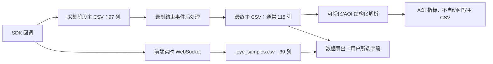

# 眼动数据与 AOI 说明

> 版本日期：2026-07-17  
> 文档状态：按当前工程实现核对后的统一主文档。  
> 替代范围：历史字段、术语、SDK 映射及 AOI 计算说明。  
> 说明：重复旧文档已经移除；发生口径冲突时，以本文件和当前代码为准。

## 1. 文档范围与事实来源

本文统一说明：

- aSeeGlasses Plus SDK 数据如何进入工程。
- 录制主 CSV、前端样本 CSV 和导出 CSV 的区别。
- 当前实际存在的字段、单位、来源和兼容字段。
- Fixation 与 Saccade 事件如何在录制结束后生成。
- 热图、轨迹图、蜂窝图、山峰图和 AOI 使用什么数据。
- AOI 的几何、时间、命中、单记录指标和多记录汇总公式。
- 当前界面中可选择、但尚无数据生产者的字段。

当前事实来源的优先级为：

1. `services/eye_tracking/application/sdk_service.py`：采集阶段主 CSV 的 97 个原始字段。
2. `services/eye_tracking/analysis/eye_event_postprocess.py`：录制结束后的事件字段和互斥写入规则。
3. `electron/main.ts`：CSV 解析、可视化事件模型、前端样本 CSV 和批量导出实现。
4. `src/features/export/ExportPage.tsx`：导出参数、表头和字段来源优先级。
5. `shared/domain/aoi/aoiReport.ts`：AOI 命中及指标公式。
6. `shared/domain/aoi/aoiMotion.ts`：动态 AOI 关键帧插值。
7. `src/features/analysis/aoi/AoiPage.tsx`：AOI 数据加载、时间过滤和多记录汇总。
8. `SDK/aSeeGlassesPlus/include/_7i_types.h`：SDK 结构体和状态枚举。

本文描述的是当前工程实现，不把通用行业定义或旧文档中的推测当作已实现功能。

## 2. 必须区分的四类数据契约



### 2.1 采集阶段主 CSV

由 Python 服务实时写入，共 97 个基础列。它保留 SDK 原始结构、项目推荐点、瞳孔、眼睑、SDK fixation 状态和实验标记。

### 2.2 最终主 CSV

停止录制并关闭 CSV 后，`postprocess_eye_event_csv()` 会重写文件：

- 保留原有 97 列。
- 追加 5 个 SDK 原始 fixation 备份列。
- 追加 13 个完成后的 Fixation/Saccade/速度事件列。
- 正常完成后共 115 列。

如果文件为空、没有 `fixation_state`，或后处理发生异常，最终列数可能不是 115。

### 2.3 前端样本 CSV

Electron 可另存 `*.eye_samples.csv`，共 39 列。它来自前端实时状态，是简化备份，不等同于最终主 CSV，也不包含全部 SDK 原始结构。

### 2.4 用户导出 CSV

导出中心根据用户勾选的字段，从主 CSV 或前端样本 CSV 读取并重命名；部分字段来自记录元数据或导出时计算。勾选 AOI 字段后，预览和导出共同读取已保存的原视频 AOI 定义并计算逐行访问结果；不回写原始 CSV，也不在缺少定义或有效位置时猜测数值。

## 3. SDK 数据结构和状态定义

### 3.1 `_7I_EYE_DATA_EX`

| SDK 成员 | 工程用途 |
| --- | --- |
| `timestamp` | 原始设备时间戳 |
| `recommend` | 推荐眼标记；桌面式在推荐结构不可用时用于左右眼回退 |
| `recom_gaze` | SDK 推荐注视结构 |
| `left_gaze` / `right_gaze` | 左右眼注视结构 |
| `left_pupil` / `right_pupil` | 左右眼瞳孔结构 |
| `left_ex_data` / `right_ex_data` | 眨眼、睁眼程度和眼睑数据 |
| `stats` | Fixation/Saccade 状态、时间、时长、样本数和中心 |
| `gyro` | 当前工程没有写入 CSV |

### 3.2 `_7I_GAZE_POINT` 有效位

`gaze_bit_mask` 的当前解释：

| bit | SDK 成员 | 工程列后缀 |
| --- | --- | --- |
| 0 | `gaze_point` | `gaze_point_x/y/z` |
| 1 | `raw_point` | `raw_point_x/y/z` |
| 2 | `smooth_point` | `smooth_point_x/y/z` |
| 3 | `gaze_origin` | `origin_x/y/z` |
| 4 | `gaze_direction` | `direction_x/y/z` |
| 5 | `re` | `re` |

眼镜式实时推荐点优先选有效的 `smooth_point`，再回退 `gaze_point`、`raw_point`；桌面式优先 `gaze_point`，再回退 `smooth_point`、`raw_point`。SDK 没有正确设置 mask 时，工程仍有兼容回退。

### 3.3 `_7I_GAZE_STATE`

| 数值 | SDK 枚举 | 当前事件解释 |
| --- | --- | --- |
| 0 | `NONE` | 无效/未分类 |
| 1 | `MOVING` | 眼跳进行中 |
| 2 | `MOVE_END` | 眼跳结束 |
| 3 | `STAYING` | 注视进行中 |
| 4 | `STAY_END` | 注视结束 |

最终可视化的一个 Fixation 事件通常取 `STAY_END(4)` 行；同一事件的 `STAYING(3)` 行不会被当成多个独立注视点。

### 3.4 瞳孔和眼睑

| SDK 字段 | 单位/范围 |
| --- | --- |
| `pupil_center` | 归一化瞳孔图像坐标 |
| `pupil_distance` | mm，瞳孔到镜头距离 |
| `pupil_diameter` | 归一化长轴，长轴像素值/图像宽度 |
| `pupil_diameter_mm` | mm |
| `pupil_minor_axis` | 归一化短轴，短轴像素值/图像宽度 |
| `pupil_minor_axis_mm` | mm |
| `blink` | SDK 状态值 |
| `openness` | 约 0～100 |
| `eyelid_up/down` | 0～1 归一化垂直位置 |

眨眼解析规则：`3`、`6` 为 active，`0`、`10` 为 inactive；其他非零数值也按 active 兼容处理。

## 4. 最终主 CSV 字段字典

### 4.1 字段数量

| 阶段 | 数量 | 组成 |
| --- | ---: | --- |
| 实时采集写入 | 97 | SDK/项目原始字段 |
| 原始值备份追加 | 5 | 后处理前 SDK fixation 值 |
| 完成事件追加 | 13 | Fixation、Saccade 和速度字段 |
| 正常最终主 CSV | 115 | 97 + 5 + 13 |

### 4.2 时间、推荐点和推荐注视结构（22 列）

| 字段 | 单位 | 定义 |
| --- | --- | --- |
| `timestamp` | SDK 定义 | SDK 原始时间戳，不保证等于视频毫秒时间 |
| `video_time_ms` | ms | 从首个写入样本开始归零的本次录制时间 |
| `recommend` | 枚举 | 0=无，1=左眼，2=右眼；眼镜式不依赖它选择推荐点 |
| `recom_gaze_x`, `recom_gaze_y` | SDK 注视坐标空间 | 项目选出的推荐展示点，不保证原始值已经是 `[0,1]` |
| `recom_gaze_bit_mask` | bitmask | 推荐注视结构有效位 |
| `recom_gaze_point_x/y/z` | SDK 坐标 | 推荐注视点 |
| `recom_raw_point_x/y/z` | SDK 坐标 | 推荐原始点 |
| `recom_smooth_point_x/y/z` | SDK 坐标 | 推荐平滑点 |
| `recom_origin_x/y/z` | SDK 3D 坐标 | 推荐视线射线起点 |
| `recom_direction_x/y/z` | 方向向量分量 | 推荐视线方向 |
| `recom_re` | SDK 定义 | 推荐注视置信度/拟合质量值 |

### 4.3 左右眼注视结构（各 17 列，共 34 列）

以下模式分别用 `left` 和 `right` 展开：

| 字段模式 | 每眼数量 | 定义 |
| --- | ---: | --- |
| `{eye}_gaze_bit_mask` | 1 | 该眼注视结构有效位 |
| `{eye}_gaze_point_x/y/z` | 3 | SDK 注视点 |
| `{eye}_raw_point_x/y/z` | 3 | 平滑前原始点 |
| `{eye}_smooth_point_x/y/z` | 3 | 平滑后点 |
| `{eye}_origin_x/y/z` | 3 | 视线射线起点 |
| `{eye}_direction_x/y/z` | 3 | 视线方向向量 |
| `{eye}_re` | 1 | 置信度/拟合质量值 |

注意：主 CSV 没有 `left_gaze_x/y` 和 `right_gaze_x/y` 这四个蛇形字段。它们只在导出兼容映射中存在；前端样本 CSV 使用驼峰字段 `leftGazeX/Y`、`rightGazeX/Y`。

### 4.4 左右眼瞳孔（各 8 列，共 16 列）

以下模式分别用 `left` 和 `right` 展开：

| 字段模式 | 单位 | 定义 |
| --- | --- | --- |
| `{eye}_pupil_bit_mask` | bitmask | 瞳孔字段有效位 |
| `{eye}_pupil_center_x/y` | 归一化坐标 | 瞳孔中心 |
| `{eye}_pupil_distance` | mm | 瞳孔到镜头距离 |
| `{eye}_pupil_diameter` | 归一化 | 瞳孔长轴 |
| `{eye}_pupil_diameter_mm` | mm | 瞳孔长轴毫米值 |
| `{eye}_pupil_minor_axis` | 归一化 | 瞳孔短轴 |
| `{eye}_pupil_minor_axis_mm` | mm | 瞳孔短轴毫米值 |

### 4.5 左右眼扩展数据（各 6 列，共 12 列）

以下模式分别用 `left` 和 `right` 展开：

| 字段模式 | 单位 | 定义 |
| --- | --- | --- |
| `{eye}_eye_data_ex_bit_mask` | bitmask | 扩展成员有效位 |
| `{eye}_blink` | SDK 状态 | 眨眼/闭眼状态 |
| `{eye}_openness` | 约 0～100 | 睁眼程度 |
| `{eye}_eyelid_up` | 0～1 | 上眼睑垂直位置 |
| `{eye}_eyelid_down` | 0～1 | 下眼睑垂直位置 |
| `{eye}_ex_data_bit_mask` | bitmask | SDK 预留扩展掩码 |

四个 mask 列保留在最终主 CSV 中，但当前导出参数面板不提供：

- `left_eye_data_ex_bit_mask`
- `right_eye_data_ex_bit_mask`
- `left_ex_data_bit_mask`
- `right_ex_data_bit_mask`

### 4.6 SDK Fixation 原始列（10 列）

| 字段 | 单位 | 采集时含义 | 录制结束后的最终含义 |
| --- | --- | --- | --- |
| `fixation_timestamp` | ms | `stats.timestamp` 换算值 | Fixation 行写完成事件开始时间；非 Fixation 事件行清空 |
| `fixation_duration` | ms | `stats.duration` 换算值 | Fixation 行写完成事件时长；其他事件行清空 |
| `fixation_timestamp_us` | µs | SDK 原始时间戳 | Fixation 行保留事件首个有效值；其他事件行清空 |
| `fixation_duration_us` | µs | SDK 原始时长 | Fixation 行改写为完成事件时长 × 1000 |
| `fixation_timestamp_ms` | ms | SDK 微秒时间戳换算 | Fixation 行写完成事件开始时间 |
| `fixation_duration_ms` | ms | SDK 微秒时长换算 | Fixation 行写完成事件时长 |
| `fixation_count` | 整数 | 参与当前 SDK fixation 的样本数 | Fixation 行改写为从 1 开始的完成事件序号 |
| `fixation_state` | 0～4 | SDK 状态 | 保持原状态，不清空 |
| `fixation_center_x/y` | SDK 坐标空间 | SDK/fallback 注视中心 | Fixation 行保留完成事件中心；其他事件行清空 |

`fixation_count` 在最终主 CSV 中已经不再表示 SDK 样本数。原始样本数保存在 `sdk_fixation_sample_count`。

### 4.7 实验上下文（3 列）

| 字段 | 定义 |
| --- | --- |
| `stimulus` | 当前刺激物名称或标识 |
| `triggerMark` | 到达当前采样时间后首次写出的触发标记 |
| `customMarker` | 当前采样行写出的一个或多个自定义标记，多个名称用逗号连接 |

### 4.8 后处理原始备份（5 列）

| 字段 | 备份来源 |
| --- | --- |
| `sdk_fixation_sample_count` | 原 `fixation_count` |
| `sdk_fixation_duration_ms_raw` | 原 `fixation_duration_ms` |
| `sdk_fixation_duration_us_raw` | 原 `fixation_duration_us` |
| `sdk_fixation_center_x_raw` | 原 `fixation_center_x` |
| `sdk_fixation_center_y_raw` | 原 `fixation_center_y` |

这些列用于保留 SDK 逐采样状态，不在当前导出参数面板中展示。

### 4.9 完成事件和速度（13 列）

| 字段 | 单位 | 适用行 | 定义 |
| --- | --- | --- | --- |
| `fixation_index` | 整数 | Fixation | 从 1 开始的完成注视事件序号 |
| `fixation_point_x_px` | px | Fixation | 完成注视中心 X 像素坐标 |
| `fixation_point_y_px` | px | Fixation | 完成注视中心 Y 像素坐标 |
| `saccade_index` | 整数 | Saccade | 从 1 开始的完成眼跳事件序号 |
| `saccade_duration_ms` | ms | Saccade | 眼跳事件持续时长 |
| `saccade_distance_px` | px | Saccade | 前后两个完成 Fixation 中心的像素距离 |
| `average_saccade_velocity_px_ms` | px/ms | Saccade | 眼跳状态区间内相邻采样像素速度的平均值 |
| `peak_saccade_velocity_px_ms` | px/ms | Saccade | 眼跳状态区间内相邻采样像素速度最大值 |
| `gaze_velocity_px_ms` | px/ms | 每个可计算采样 | 当前推荐点相对上一有效推荐点的像素速度 |
| `gaze_velocity_deg_ms` | deg/ms | 每个可计算采样 | 当前视线方向相对上一有效方向的角速度 |
| `saccade_distance_deg` | deg | Saccade | 前后两个完成 Fixation 视线方向的夹角 |
| `average_saccade_velocity_deg_ms` | deg/ms | Saccade | 眼跳状态区间内相邻方向角速度平均值 |
| `peak_saccade_velocity_deg_ms` | deg/ms | Saccade | 眼跳状态区间内相邻方向角速度最大值 |

## 5. 完成事件生成规则

### 5.1 事件分组

后处理按 CSV 行顺序把连续状态归为事件：

```text
state 3/4 连续区间 → Fixation 事件
state 1/2 连续区间 → Saccade 事件
state 0 或无状态   → 不属于事件
```

状态从 3 变为 4 仍属于同一个 Fixation；状态从 1 变为 2 仍属于同一个 Saccade。

### 5.2 序号

- Fixation 事件按时间顺序从 1 开始编号。
- Saccade 事件按时间顺序从 1 开始独立编号。
- 第一个完成 Fixation 之前出现的运动状态不编号为 Saccade。
- 同一事件覆盖的多行使用同一个事件序号。

### 5.3 Fixation 与 Saccade 字段互斥

Fixation 行：

- 填写 `fixation_index`、Fixation 时间、时长和中心。
- `saccade_index` 及 Saccade 事件字段为空。

Saccade 行：

- 填写 `saccade_index`、时长、距离和速度。
- Fixation 时间、时长、序号和中心字段为空。

未分类行：

- Fixation/Saccade 事件字段均为空。
- `fixation_state` 和原始备份字段仍可用于诊断。

### 5.4 Fixation 时长和中心

```text
Fixation 时长 = 事件内有效 fixation_duration_ms 的最大值
若没有有效值 = max(0, 事件结束时间 - 事件开始时间)
```

中心优先取该事件最后一个可解析的 `fixation_center_x/y`。

像素转换：

```text
眼镜式 centered 坐标：px = raw + frameSize / 2
0～1 归一化坐标：px = raw × frameSize
其他坐标：按像素值直接使用
```

结果限制在 `[0, frameWidth] × [0, frameHeight]`。

### 5.5 Saccade 时长、距离和速度

```text
Saccade 时长 = 下一事件开始时间 - 当前 Saccade 开始时间
若没有下一事件 = 当前 Saccade 最后时间 - 开始时间

Saccade Distance[px]
= sqrt((nextFixX-prevFixX)^2 + (nextFixY-prevFixY)^2)

逐采样 Gaze Velocity[px/ms]
= 相邻推荐点像素距离 / 时间差(ms)

逐采样 Gaze Velocity[deg/ms]
= 相邻归一化方向向量夹角(deg) / 时间差(ms)
```

平均/峰值眼跳速度只对当前 Saccade 状态区间内可计算的逐采样速度求平均或最大值。

如果一个 Saccade 后没有下一个完成 Fixation，其序号和时长仍可能存在，但前后 Fixation 距离可能为空。

## 6. 前端样本 CSV（39 列）

文件名：`<recordName>.eye_samples.csv`。

| 分类 | 字段 |
| --- | --- |
| 时间 | `timestamp` |
| 推荐/左右眼实时点 | `recomGazeX`, `recomGazeY`, `leftGazeX`, `leftGazeY`, `rightGazeX`, `rightGazeY` |
| 左眼瞳孔 | `leftPupilCenterX`, `leftPupilCenterY`, `leftPupilDiameter`, `leftPupilDiameterMm` |
| 右眼瞳孔 | `rightPupilCenterX`, `rightPupilCenterY`, `rightPupilDiameter`, `rightPupilDiameterMm` |
| 左眼扩展 | `leftBlink`, `leftOpenness`, `leftEyelidUp`, `leftEyelidDown` |
| 右眼扩展 | `rightBlink`, `rightOpenness`, `rightEyelidUp`, `rightEyelidDown` |
| Fixation | `fixationTimestampMs`, `fixationDurationMs`, `fixationTimestampUs`, `fixationDurationUs`, `fixationCount`, `fixationState`, `fixationCenterX`, `fixationCenterY` |
| 前端运动量 | `gazeVelocityMs`, `saccadeAmplitude`, `saccadeDurationMs`, `saccadeVelocity`, `saccadePeakVelocity` |
| 实验上下文 | `stimulus`, `triggerMark`, `customMarker` |

该文件没有最终主 CSV 的 `fixation_index`、`saccade_index`、像素/角度事件字段，也没有完整 SDK gaze、pupil mask 和原始备份字段。

## 7. 导出参数和导出字段

### 7.1 当前字段数量

导出以原有 **133 列及顺序、表头为唯一标准**。此前新增的 74 个可选扩展列已取消，来源和质量信息只在内部用于数据判断。此处替代早期文档中 124 列的旧计数。

受试者字段按 `subject_info::<URL编码字段名>` 动态加入，不计入上述数量，默认不选。逐字段定义和设备适用性见[导出字段说明](导出字段说明.md)，默认列和顺序由实际预览/导出回归固定检查。

### 7.2 基础字段

| 导出 key | 输出表头/含义 | 来源 |
| --- | --- | --- |
| `record_name` | 记录名称 | 记录元数据 |
| `user` | `User` | 受试者名称 |
| `eye_data_record` | 记录 ID | 记录元数据 |
| `time_of_day` | `Time of Day[HH:mm:ss.ms]` | 真实开始时刻加有效视频时间，或可辨认的历史 epoch；无可靠时钟依据留空 |
| `video_time_ms` | `Video Time[HH:mm:ss.ms]` | 原始 `video_time_ms` 格式化 |
| `timestamp` | `Timestamp[ms]` | 优先明确的 `video_time_ms`，该列存在而行值缺失时保持缺失；旧无视频列保留兼容路径，不能推定其单位 |
| `tracking_ratio_pct` | `Tracking Ratio[%]` | 记录元数据 |
| `sampling_rate_hz` | 实际采样率 | 记录元数据 |
| `configured_sampling_rate_hz` | 配置/数据采样率 | 记录元数据 |
| `record_duration_s` | 记录时长 | 记录元数据 |

时间和 timestamp 类字段会在导出值前加制表符，避免表格软件自动改写文本。

### 7.3 Fixation 导出映射

| 导出 key | 输出表头 | 来源优先级 |
| --- | --- | --- |
| `fixation_timestamp` | `Fixation Timestamp[ms]` | `fixation_timestamp_ms` → `fixation_timestamp` → `fixationTimestampMs` |
| `fixation_duration` | `Fixation Duration[ms]` | `fixation_duration_ms` → `fixation_duration` → `fixationDurationMs` |
| `fixation_count` | `Fixation Index` | `fixation_index` → `fixation_count` → `fixationCount` |
| `fixation_state` | 注视状态 | `fixation_state` → `fixationState` |
| `fixation_center_x` | `Fixation Point X[px]` | `fixation_point_x_px` → `fixation_center_x` → `fixationCenterX` |
| `fixation_center_y` | `Fixation Point Y[px]` | `fixation_point_y_px` → `fixation_center_y` → `fixationCenterY` |

兼容提醒：新主 CSV 有 `fixation_point_*_px`，输出单位确实是 px；旧 CSV 或 `.eye_samples.csv` 回退到 `fixation_center_*` 时，值可能仍是归一化或 SDK 坐标，但表头仍显示 `[px]`。

### 7.4 Saccade 导出映射

| 导出 key | 输出表头 | 新主 CSV 来源 |
| --- | --- | --- |
| `saccade_index` | `Saccade Index` | `saccade_index` |
| `saccade_duration_ms` | `Saccade Duration[ms]` | `saccade_duration_ms` |
| `saccade_distance_px` | `Saccade Distance[px]` | `saccade_distance_px` |
| `average_saccade_velocity_px_ms` | `Average Saccade Velocity[px/ms]` | `average_saccade_velocity_px_ms` |
| `peak_saccade_velocity_px_ms` | `Peak Saccade Velocity[px/ms]` | `peak_saccade_velocity_px_ms` |
| `gaze_velocity_px_ms` | `Gaze Velocity[px/ms]` | `gaze_velocity_px_ms` |
| `gaze_velocity_deg_ms` | `Gaze Velocity[deg/ms]` | `gaze_velocity_deg_ms` |
| `saccade_distance_deg` | `Saccade Distance[deg]` | `saccade_distance_deg` |
| `average_saccade_velocity_deg_ms` | `Average Saccade Velocity[deg/ms]` | `average_saccade_velocity_deg_ms` |
| `peak_saccade_velocity_deg_ms` | `Peak Saccade Velocity[deg/ms]` | `peak_saccade_velocity_deg_ms` |
| `gaze_velocity_ms` | 眼动速度(归一化/ms) | 主 CSV 缺失时，导出按相邻坐标和时间差计算 |
| `saccade_amplitude` | 眼跳幅度(归一化) | 新主 CSV 当前不生成；仅兼容已有同名列/前端样本 CSV |

导出时派生的 `gaze_velocity_ms` 是相邻可用坐标的归一化距离/时间差，不是完成 Saccade 事件的平均速度。

### 7.5 软件派生及通信字段

以下字段属于软件分析或实际外设通信，不是眼动设备的原生测量。它们仍占用原有 133 列中的对应位置，不新增导出列。

AOI 7 字段：

- `aoi_id`
- `aoi_name`
- `aoi_hit`
- `aoi_enter_time_ms`
- `aoi_exit_time_ms`
- `aoi_dwell_time_ms`
- `aoi_fixation_count`

通信 4 字段：

- `udp_send`
- `udp_receive`
- `trigger_send`
- `trigger_receive`

AOI 7 列已在预览和导出时接通，入口为 `electron/domains/recording/recordAoiExport.ts`，逐行规则为 `shared/domain/aoi/aoiExport.ts`。它们复用已保存定义的几何、关键帧和时间范围，以及完整源注视/既有回退注视索引，不将 AOI 页整段 `AoiStatsRow` 汇总复制到每行，也不回写原始 CSV。

`aoi_hit` 仅在有效采样、有效几何和启用时间范围内填写 1（内部）或 0（外部）。`enter` 是本次访问首个内部采样；`exit` 仅写在连续可信的第一个外部采样；`dwell` 为末次内部采样减首次内部采样，不外推到离开时刻。超过 100 ms 断档、无效、时间倒退、来源变化或停用范围切断访问，末尾及这些中断均不补造离开时间。事件/纯标记行不作为采样，也不打断真实采样的连续性。

`aoi_fixation_count` 只计本次访问中截至当前行已经结束的去重完成注视：起点在当前访问及启用范围内，中心命中起始时刻的区域。缺少可靠事件依据或索引所需真实视频尺寸时计数未知；不写默认 0。单个 AOI 使用标量，多个 AOI 的全部 7 列使用存储顺序一致的 JSON 数组，未知分量为 `null`；ID/名称列包含同作用域全部定义，重叠不复制采样行。

定义优先使用 `visualization/aoi.json` 中的 `record:<记录ID>`，Pupil/眼镜兼容旧裸 ID；不猜桌面刺激物作用域，不将映射底图区域套到原视频坐标。未配置时 Pupil 留空，旧设备已有原 AOI 列保留；损坏文件明确报错。完整字段定义见 [导出字段说明](导出字段说明.md#aoi-数据)。

通信四列已由 Electron 实际 UDP/串口收发接入 Pupil 录制。成功发送、实际收到的字节、捕获时间和本次录制/连接身份进入独立持久化日志，再合入最终 CSV；停止先排空 I/O，断连恢复按事件 ID 合并去重。文本/二进制使用单行 JSON envelope 无损保存，通信事件不当眼动采样。串口接收是字节块而非协议包；发送成功不代表外设执行。配置、时钟及错误边界详见 [导出字段说明](导出字段说明.md#自定义数据)。

### 7.6 兼容字段和不直接导出的字段

- `left_gaze_x/y`、`right_gaze_x/y`：主 CSV 没有，兼容 `.eye_samples.csv` 的驼峰字段。
- 4 个眼睑 mask：主 CSV 有，导出参数已隐藏。
- 5 个 `sdk_fixation_*_raw`：主 CSV 有，导出参数未提供。
- `fixation_timestamp_us`、`fixation_duration_us`：主 CSV 有，但导出参数只提供毫秒版 Fixation 时间和时长。
- `fixation_index`、`fixation_point_x_px/y_px`：通过兼容 key `fixation_count`、`fixation_center_x/y` 导出，不单独显示为参数 key。

## 8. 可视化和结构化解析

### 8.1 `HeatmapPoint` 内部模型

CSV 结构化解析后的核心字段：

| 字段 | 定义 |
| --- | --- |
| `x`, `y` | `[0,1]` 可视化坐标 |
| `timestamp` | 事件时间，后续统一为 ms |
| `weight` | Fixation/事件持续时长，ms |
| `id` | Fixation 或 Saccade 事件序号 |
| `fixationState` | SDK 状态 0～4 |
| `pupilDiameter` | 左右眼有效直径平均值或单眼值 |
| `saccadeDurationMs` | 眼跳时长 |
| `saccadeAmplitude` | 归一化幅度或兼容输入值 |
| `saccadeVelocity` | 归一化/ms 或兼容输入值 |
| `saccadePeakVelocity` | 峰值速度 |
| `saccadeStartX/Y`, `saccadeEndX/Y` | 兼容显式路径字段 |
| `blink`, `leftBlink`, `rightBlink` | 眨眼状态 |
| `stimulusName`, `triggerMark`, `customMarker` | 实验上下文 |
| `markerOnly` | 仅标记行，不作为注视点 |

### 8.2 当前四种可视化的数据口径

当前以下四种可视化全部请求 `pointMode: 'fixation'`：

- 热图
- 注视轨迹图
- 蜂窝图
- 山峰图

新主 CSV 优先读取完成后的 `fixation_index` 和 `fixation_point_x_px/y_px`；Fixation 模式通常只把 `STAY_END(4)` 作为一个完成事件点。旧 CSV 没有 `fixation_index` 时，解析器会为 `state=4` 的事件从 1 开始生成兼容序号。

### 8.3 注视点来源选择

Gaze 模式或 Fixation 回退可能选择：

- `smooth`：优先平滑点。
- `recommended`：优先项目推荐点。
- `raw`：优先原始点。

当前四种主要可视化使用完成 Fixation 事件；这些 Gaze 来源主要用于兼容回退和其他显示链路。

### 8.4 眼镜坐标空间

眼镜式解析兼容：

- `normalized`：直接使用 0～1。
- `centered_pixels`：`(raw + frameSize/2) / frameSize`。
- `centered_small`：对小范围中心坐标做经验映射。

新主 CSV 有 `fixation_point_x_px/y_px` 时，解析器直接除以记录画面宽高，得到 0～1 坐标。

## 9. AOI 定义和命中

### 9.1 AOI 数据结构

| 字段 | 定义 |
| --- | --- |
| `id`, `name` | AOI 标识和名称 |
| `type` | `rect`、`ellipse`、`polygon` |
| `visible` | 是否显示；底层统计函数本身不会自动排除不可见 AOI |
| `showStats` | 是否显示统计面板 |
| `color` | 显示颜色 |
| `activationTimeMs` | 最早参与统计时间，默认 0 |
| `analysisTimeRanges` | AOI 自有统计时间段 |
| `keyframes` | 动态 AOI 几何关键帧 |

AOI 保存在：

```text
<projectDir>/visualization/aoi.json
```

当前格式版本为 3，实际作用域键由 `aoiStorageScopeId` 决定：眼镜式通常按记录，桌面式也可能按刺激物。

### 9.2 坐标归一化

AOI 使用视频/刺激物实际绘制区域的 0～1 坐标，播放器留黑不属于 AOI：

```text
x_norm = (x_canvas - drawLeft) / drawWidth
y_norm = (y_canvas - drawTop) / drawHeight
w_norm = w_canvas / drawWidth
h_norm = h_canvas / drawHeight
```

### 9.3 几何命中

矩形：

```text
x >= left && x <= left + width
y >= top  && y <= top  + height
```

椭圆：

```text
((x-cx)/rx)^2 + ((y-cy)/ry)^2 <= 1
```

多边形使用射线奇偶规则。重叠 AOI 独立统计，同一个 Fixation 可以同时命中多个 AOI。

### 9.4 动态 AOI

- 基础几何是 0 ms 隐含关键帧。
- 矩形/椭圆的 `x/y/w/h` 在相邻关键帧间线性插值。
- 多边形顶点数量相同时逐点插值。
- 多边形顶点数量不同时，前半段用前一形状，后半段用后一形状。
- 最后一个关键帧之后保持最后形状。
- Fixation 命中使用事件时刻的 AOI。
- 眼跳路径对开始、中点、结束三个时刻的动态 AOI 做近似相交判断。

### 9.5 AOI 时间范围

有效起点：

```text
effectiveStart = max(activationTimeMs, analysisRange.startTimeMs)
```

- 没有 AOI 自有范围时使用 `[activationTimeMs, +∞)`。
- 配置范围但全部禁用时，没有有效统计点。
- 自有范围不允许重叠；无效和重叠的后续范围会被忽略。
- 跨不连续范围时访问状态重置。
- 桌面视频刺激物可把全局记录时间换算为刺激物片段局部时间。
- 有视频时，统计默认累计到当前播放头；播放头截止值会应用 `timeOffsetMs`。

### 9.6 AOI 使用的数据

AOI 页加载：

```ts
{
  pointMode: 'fixation',
  includeSdkSaccades: true,
  includeMarkerOnlyRows: true
}
```

因此：

- 注视指标按完成 Fixation 事件计算，不按原始 Gaze 行数。
- SDK `state=1/2` 眼跳事件会进入 AOI 眼跳统计。
- 标记行用于时间线，但不作为注视点。
- 当前解析器能读取新主 CSV 的 `saccade_duration_ms`；像素距离和像素速度列主要用于导出，AOI 内部速度/幅度仍按归一化事件模型或兼容字段计算。

### 9.7 眼跳归属 AOI

眼跳只要满足以下任一条件即认为经过 AOI：

- 起点在 AOI 内。
- 终点在 AOI 内。
- 路径与矩形、多边形边界相交。
- 路径与椭圆有交点。

SDK 状态眼跳只在终止事件计数一次。显式路径眼跳需要有效起终点，并至少有时长、幅度、速度或峰值之一。

## 10. AOI 单记录指标

### 10.1 注视指标

| 中文名称 | 字段 | 当前公式/定义 |
| --- | --- | --- |
| 注视次数 | `fixationCount` | AOI 内非眼跳完成 Fixation 数 |
| 首次注视前时长(ms) | `firstEnterTimeMs` | 首次命中时间 - 所在有效范围开始时间 |
| 首次注视前次数 | `fixationCountPreEntry` | 首次命中前、有效范围内且坐标有效的 Fixation 数 |
| 首次注视时长(ms) | `firstFixationDurationMs` | 首次命中 Fixation 的有效时长 |
| 总注视时长(ms) | `totalDurationMs` | 命中 Fixation 有效时长之和 |
| 平均注视时长(ms) | `avgDurationMs` | `totalDurationMs / fixationCount` |
| 最大注视时长(ms) | `maxFixationDurationMs` | 命中 Fixation 最大时长 |
| 最短浏览时间(ms) | `minFixationDurationMs` | 实际为命中 Fixation 最小时长 |
| 第二次注视时间(ms) | `secondFixationDurationMs` | 第二个命中 Fixation 的时长 |
| 长注视次数 | `longFixationCount` | 时长 `>= 2000 ms` 的命中 Fixation 数 |
| 回视时间(ms) | `regressionDurationMs` | 总注视时长 - 首次访问内注视时长 |

Fixation 持续时长取内部事件 `weight`；跨越有效时间范围边界时只累计重叠部分。

### 10.2 访问和停留

一次访问在事件状态从 AOI 外变为 AOI 内时开始：

```text
inside(current) = true && inside(previous) = false → visits += 1
```

| 中文名称 | 字段 | 当前公式/定义 |
| --- | --- | --- |
| 访问次数 | `visits` | outside → inside 转换次数 |
| 回看次数 | `revisitCount` | `max(0, visits - 1)` |
| 注视人数 | `visitorCount` | 单记录 Fixation 命中数 > 0 时为 1 |
| 回看人数 | `reVisitorCount` | 单记录 `visits > 1` 时为 1 |
| 总停留时长(ms) | `totalVisitDurationMs` | 总注视时长 + 经过 AOI 的总眼跳时长 |
| 首次停留时长(ms) | `firstVisitDurationMs` | 首次访问注视时长 + 首次访问眼跳时长 |
| 首次停留注视时长(ms) | `firstVisitFixationDurationMs` | 首次访问结束前的命中 Fixation 时长之和 |
| 首次停留注视次数 | `firstVisitFixationCount` | 首次访问结束前的命中 Fixation 数 |
| 平均停留时长(ms) | `avgVisitDurationMs` | `totalVisitDurationMs / visits` |

当前“停留时长”不是简单的离开时间减进入时间。眼跳端点进入 AOI 也可能触发一次访问，但单记录 `visitorCount` 仍要求有 Fixation 命中。

### 10.3 眼跳指标

| 中文名称 | 字段 | 当前公式/定义 |
| --- | --- | --- |
| 总眼跳时长(ms) | `totalSaccadeDurationMs` | 经过 AOI 的眼跳时长之和 |
| 眼跳次数 | `saccadeCount` | 经过 AOI 的完整眼跳数 |
| 平均眼跳时长(ms) | `avgSaccadeDurationMs` | 总眼跳时长 / 眼跳次数 |
| 平均眼跳速度(px/ms) | `avgSaccadeVelocity` | 有有效速度的眼跳按事件数取平均，不按幅度加权 |
| 平均眼跳幅度(px) | `avgSaccadeAmplitude` | 有有效幅度的眼跳平均值 |
| 眼跳速度峰值(px/ms) | `peakSaccadeVelocity` | 有效峰值最大值；明确像素来源缺失时保持缺失，不用平均速度代替 |

AOI 对标有 `saccadeMetricUnit=pixels` 的指标直接采用，不再乘视频宽度；历史归一化来源仍保留原有宽度换算规则，不能视为精确视角换算。无有效幅度/速度/峰值时内部为 `null`、界面为 `-`。比较报告单独按实际单位标注；像素与归一化混合时不合算这两项指标。像素指标受视频分辨率和成像条件影响，不能当作跨设备物理角度。

### 10.4 瞳孔和眨眼扩展

| 中文名称 | 字段 | 当前公式/定义 |
| --- | --- | --- |
| 平均瞳孔直径(mm) | `avgPupilDiameter` | AOI 内具有合格毫米瞳孔值、有效注视位置的真实采样平均值 |
| 瞳孔样本数 | `pupilSampleCount` | 参与平均的真实采样行数，不是注视事件数 |
| 总眨眼时长(ms) | `totalBlinkDurationMs` | 其他设备沿用 AOI 连续状态路径；Pupil 缺可靠空间定位时为缺失 |
| 眨眼次数 | `blinkCount` | 其他设备沿用 inactive → active 计数；Pupil 未定位区间不分配给 AOI |
| 平均眨眼时长(ms) | `avgBlinkDurationMs` | 其他设备沿用总时长 / 次数；Pupil 未定位时保持缺失 |

单个采样的瞳孔值：双眼都有有效值时取平均；只有单眼有效时使用该眼。排除非正/非有限值、明确无效的毫米测量、bad 三维模型和该眼眨眼；旧记录缺少质量声明时保持兼容，不能宣称已验证其模型质量。Pupil 的未标单位直径是眼图像像素，不能作为毫米回退值。

统计页面通过既有 `load-record-points` 的 `includePupilSamples` 获取独立完整瞳孔采样。整段瞳孔均值和曲线允许合格瞳孔但无有效 gaze 位置的采样；AOI 按每个样本的真实时间和当时区域形状判断，排除无有效位置的样本。样本不参与注视/眼跳/眨眼事件计数和轨迹，不用事件率推算设备 Hz。均值按采样行等权，不代表按时间积分，也不是对底层所有 eye-camera pupil 帧去重统计。

Pupil 眨眼区间通过同一 `includePupilSamples` 请求返回独立的 `blinkData`。只接收同一会话、眼别和配对编号的有效 onset/offset；冲突、未配对和非法区间不转为完整事件。区间不带伪造的 gaze 坐标。Chart 展示整段完整区间，Compare 按以下规则统计并在导出保留口径：

- 次数按起始时间落入左闭右开时间窗计数，相邻时间窗边界不重复。
- 总时长是区间与时间窗的交集之和；平均时长是起始落入时间窗的事件的**完整源时长**平均，因此局部时间窗的总时长不一定等于次数乘平均时长。
- 左右眼分别计数，同时发生也为两个眼事件；时长按眼相加，不等于双眼合并的墙钟时长。Capture 未提供眼别时保留未指定，不与原生按眼事件假定同口径。
- 无完整配对（包括旧记录缺少配对字段）保持缺失，不认定真实眨眼为零。部分配对成功仅代表已观察到的完整区间，未配对阶段数量另报。
- 刺激物筛选只能使用 onset 的源标签；没有精确刺激物边界时，重叠时长保持缺失。不能用最近一个 gaze 或注视中心定位闭眼期间的区域。
- AOI 的 Pupil 眨眼次数、时长及均值为 `null`，界面显示缺失及“完整区间无法分配/未观察到”的原因。其他设备维持已有路径，多记录汇总不把 Pupil 缺失变成零。

统计读取不静默抽样；单次事件或合格瞳孔采样超过 100 万点、眨眼配对键超过 10 万时明确失败，超大记录流式精确聚合待实现。已有视频毫秒时间不平移、不拉伸；旧未标时间基准的记录保留历史兼容处理。

## 11. AOI 多记录汇总

先对每条记录独立计算，再按 `aoiId` 汇总。受试者键优先使用 `subjectName`，缺失时使用 `recordId`。

| 指标类别 | 汇总方式 |
| --- | --- |
| 注视数、总时长、访问数、回看数、眼跳数、眨眼数、回视时间、长注视数 | 求和 |
| 平均注视时长 | 汇总总注视时长 / 汇总注视次数 |
| 平均停留时长 | 汇总总停留时长 / 汇总访问次数 |
| 平均眼跳时长 | 汇总总眼跳时长 / 汇总眼跳次数 |
| 最大注视时长、峰值速度 | 各记录最大值 |
| 最短注视时长 | 各记录有效最小值 |
| 首次注视前时长 | 有首次命中记录之间平均 |
| 首次注视前次数、首次注视时长、首次访问指标 | 有访问者记录之间平均 |
| 第二次注视时长 | 各记录非零值之间平均 |
| 平均眼跳速度、平均眼跳幅度 | 按对应有效样本数加权平均 |
| 平均瞳孔直径 | 按 `pupilSampleCount` 加权平均 |
| 注视人数 | 按受试者键去重后，有访问或注视的受试者数 |
| 回看人数 | 按受试者键去重后，存在回看的受试者数 |
| 首次注视序号 | 各记录有效值的最小值 |

未访问 AOI 的记录通常不会以 0 进入“平均首次……”指标的分母。

## 12. 网格 AOI

网格模式把画面划分成 `rows × cols` 个普通矩形 AOI：

```text
x = col / cols
y = row / rows
w = 1 / cols
h = 1 / rows
```

网格单元复用相同的 AOI 统计函数。颜色在当前有值网格的最小值和最大值之间线性映射，蓝色代表较小值，红色代表较大值。

## 13. 当前字段支持矩阵

| 字段/功能 | 最终主 CSV | `.eye_samples.csv` | 导出可选 | 可视化/AOI 使用 |
| --- | --- | --- | --- | --- |
| 完成 Fixation 序号和像素中心 | 有 | 无 | 有，使用兼容 key | 四种可视化和 AOI |
| 完成 Saccade 序号、px/deg 指标 | 有 | 无 | 有 | 导出；AOI主要使用状态事件和内部归一化模型 |
| SDK 原始 gaze 结构 | 有 | 简化 | 大部分有 | 兼容回退 |
| 左右眼实时 `leftGazeX/Y` | 无蛇形列 | 有 | 有兼容项 | 实时/旧样本兼容 |
| SDK 原始 fixation 备份 | 有 | 无 | 无 | 诊断 |
| 瞳孔 mm | 有 | 有直径 | 有 | AOI 平均瞳孔 |
| 眼睑 mask | 有 | 无 | 无 | 当前不参与 AOI 指标 |
| blink/openness/eyelid | 有 | 有 | 有 | blink 参与 AOI 扩展统计 |
| AOI 7 个逐行导出字段 | 不回写原始 CSV | 无 | 有；按已保存原视频定义及完整记录条件计算 | 共用几何与注视来源，逐行访问口径独立于整段汇总 |
| UDP/串口收发字段 | Pupil 实际收发事件行 | 无 | 有；仅实际收发时填写 | 不参与采样或分析事件统计 |
| 动态受试者属性 | 元数据 | 元数据 | 按配置动态出现 | 不参与点级计算 |

## 14. 与旧文档相比的主要修正

1. 最终 `fixation_count` 现在是完成事件序号；SDK 原始样本数已迁移到 `sdk_fixation_sample_count`。
2. 新增独立的 `fixation_index` 和 `saccade_index`，均从 1 开始，且事件字段互斥。
3. 新增 Fixation 像素中心、Saccade 像素/角度距离和速度字段。
4. 蜂窝图和山峰图已经与热图、轨迹图统一使用完成 Fixation 事件。
5. AOI 眼跳不会无条件把任意相邻 Fixation 都当成显式眼跳；当前优先使用 SDK `state=1/2` 或完整显式字段。
6. AOI 平均瞳孔直径按有效瞳孔样本数计算，不按全部 Fixation 数计算。
7. AOI 7 个导出字段已连接同一预览/导出计算入口；未配置、无效和缺失保持未知，重叠 AOI 使用同序数组。
8. 主 CSV 和导出 CSV 是两个合同：眼睑 mask 可保留在主 CSV，同时从导出参数隐藏。
9. `left_gaze_x/y`、`right_gaze_x/y` 不是当前主 CSV 字段，只是前端样本兼容映射。
10. AOI 页面“总停留时长”是注视时长加眼跳时长；逐行导出 `aoi_dwell_time_ms` 是当前访问已观察到的内部采样跨度，两者不可混用。

## 15. 验收与维护清单

### 15.1 录制数据验收

- 新录制正常结束后是否为 115 列。
- `fixation_index`、`saccade_index` 是否分别从 1 连续编号。
- Saccade 行是否没有 Fixation 事件值。
- Fixation 行是否没有 Saccade 事件值。
- 第一个 Fixation 前的运动是否未编号。
- `sdk_fixation_sample_count` 是否保留原 SDK count。
- 像素中心是否在画面范围内。
- 事件速度单位是否与列名一致。

### 15.2 导出验收

- 预览表头与最终导出表头是否一致。
- 新主 CSV 是否优先使用 `fixation_index` 和像素中心。
- AOI 和通信空字段是否被误认为已有分析结果。
- 眼睑 mask 是否仍保留在原始主 CSV、但不显示在导出参数。
- 旧 CSV 回退到 `fixation_center_x/y` 时是否正确解释单位。

### 15.3 AOI 回归测试

- 矩形、椭圆、多边形的内外和边界点。
- 重叠 AOI 同时命中。
- 动态 AOI 关键帧前、插值中和最后关键帧后。
- Fixation 时长跨统计范围边界的裁剪。
- 眼跳起终点在外、路径穿过 AOI。
- 不连续 AOI 时间范围之间访问状态重置。
- 全部自有范围禁用。
- 单记录 0、1、2 次访问。
- 同一受试者多记录的人数去重。
- 多记录求和、平均、最大、最小和加权平均。

### 15.4 修改代码时必须同步检查

- 修改原始字段：`services/eye_tracking/application/sdk_service.py`。
- 修改完成事件：`eye_event_postprocess.py`。
- 修改导出字段：`ExportPage.tsx` 与 `electron/main.ts`。
- 修改可视化数据源：CSV 解析器和 `visualHeatmapEffect.ts`。
- 修改 AOI 指标：`aoiReport.ts`、`AoiPage.tsx`。
- 修改动态 AOI：`aoiMotion.ts`。
- 修改任一口径后同步更新本文。
